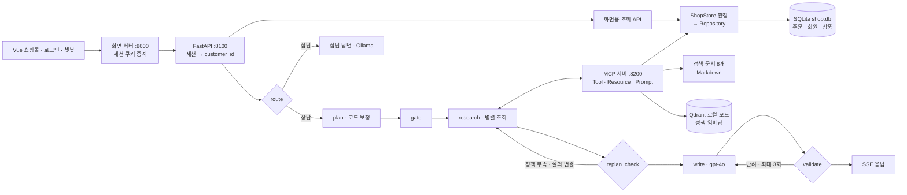
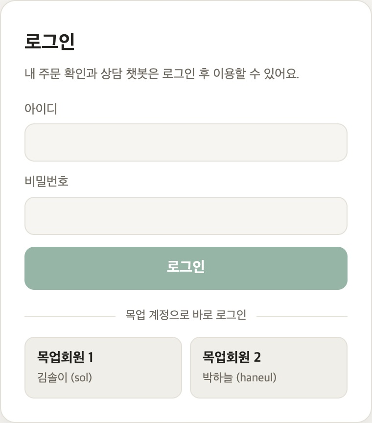
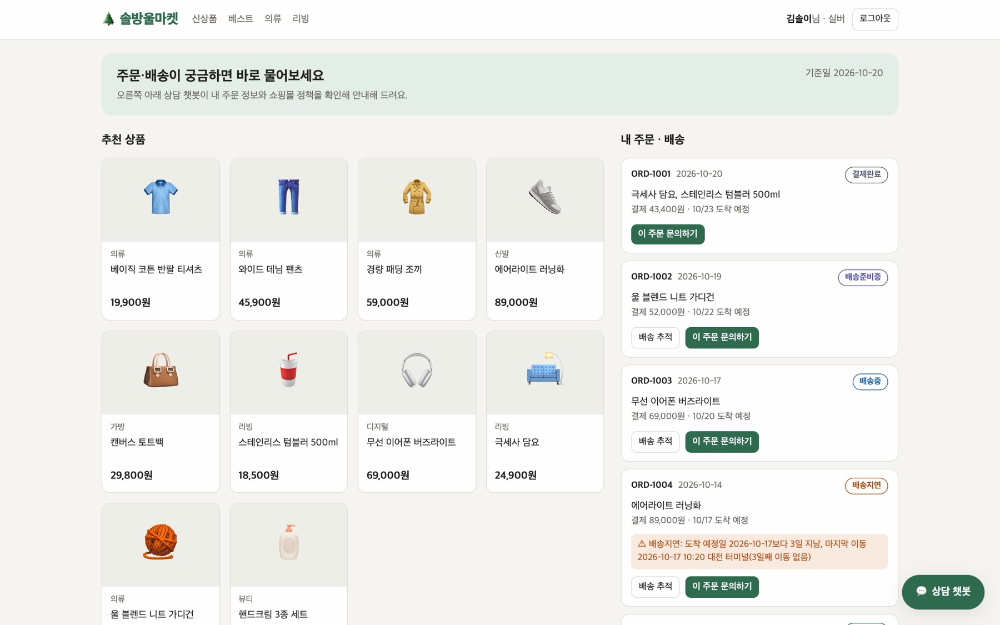
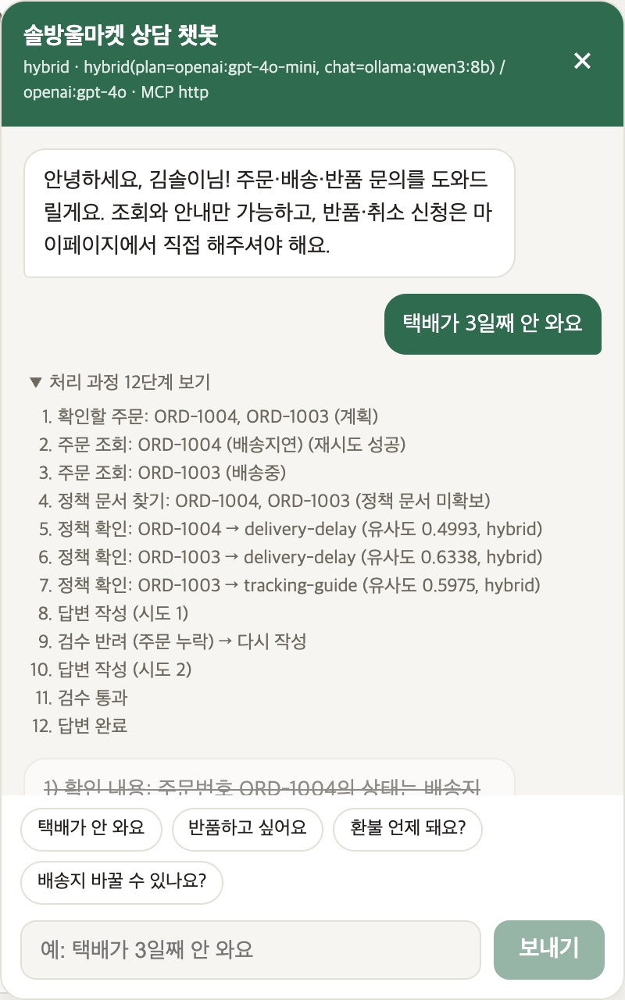
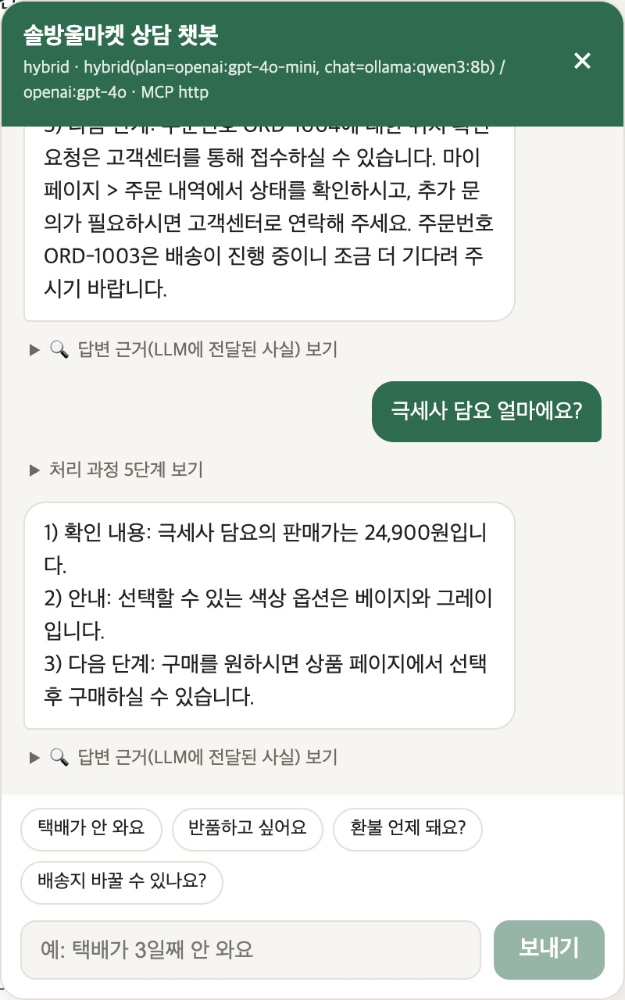
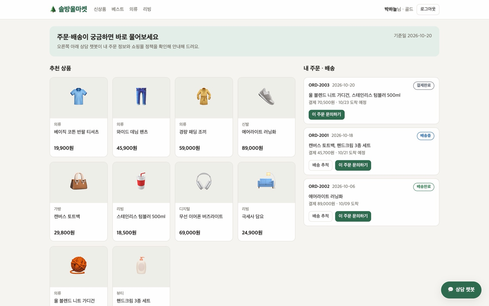
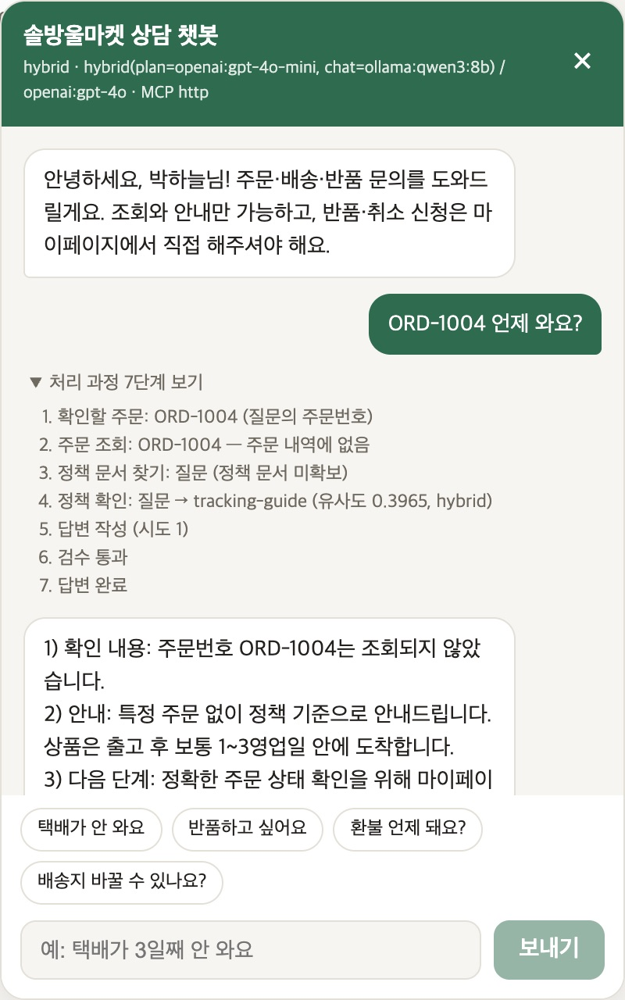
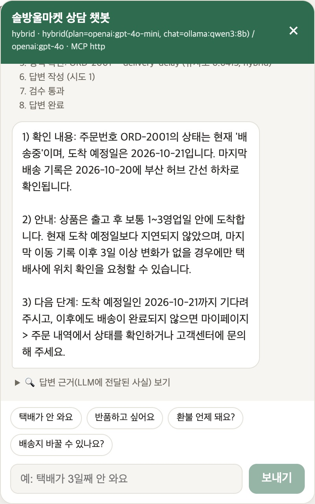

**SKALA 광주 2반 · G063 정구현**

# 쇼핑몰 주문·배송 상담 에이전트

가상 쇼핑몰 '솔방울마켓'의 주문·배송 상담 챗봇이다. 이전 과제인 장애 대응 에이전트의 FastAPI·Vue·LangGraph·MCP 구조를 쇼핑몰 상담으로 옮기면서, **챗봇이 그럴듯한 값을 지어내지 않도록** 세 가지를 만들었다. 질문 속 주문을 코드로 보정해 찾고, 정책 문서를 의미로 검색하고, 답변 속 값을 수집된 사실과 대조한다. 실서비스를 가정해 주문 데이터는 SQLite 저장소로 분리했고, 로그인한 회원의 주문만 조회되게 했다. 챗봇은 조회·안내만 하고 반품·취소 접수는 하지 않는다.

> 상품·주문·회원은 모두 목업 데이터이고, 솔방울마켓은 실존하지 않는다. Before/After는 실제 OpenAI(gpt-4o-mini·gpt-4o)와 로컬 Ollama(qwen3:8b)로 **설정마다 1회** 측정했다. 벡터 검색은 Qdrant 서버가 아니라 **로컬 파일 모드**로 돌렸다. LLM-as-a-Judge는 도입하지 않았고 정답이 있는 지표로 평가했다(이유는 §6).

## 관련 문서

| 자료 | 목적 |
|---|---|
| [최종 보고서](doc/final_report.md) | 과제 제출용 보고서: 문제 정의, 기술 요소, 구현 결과, 교훈 |
| [상세 설계·실행 가이드](doc/README.md) | 노드별 설계, 1~4차 측정 기록 전체, 실행 순서 |
| [평가셋](eval/dataset.json) / [측정 결과 원본](eval/results/) | 정답 기반 평가 25문항, 검색 dev 질문 30개, 1~4차 결과 JSON |

## 1. 진행 사항과 개선 범위

**선택 과제: 과제 2 — 신규 프로젝트.** 장애 대응 에이전트의 구조를 재사용해 쇼핑몰 주문·배송 상담이라는 새 주제를 구현했다.

상담 챗봇에서는 자연스러운 문장보다 **답에 나온 주문번호·도착일·금액·기간이 실제 값인지**가 먼저 확인되어야 한다. 구현하고 측정하면서 다음 여섯 문제를 개선 대상으로 정했다.

| 개선 영역 | 기존 문제 | 구현한 변경 | 주요 코드 |
|---|---|---|---|
| 주문 식별 | LLM이 고른 주문을 그대로 믿음. "환불 언제 돼요?"를 일반 질문으로 분류해 반품 중인 주문을 4번 실행 모두 조회하지 않음 | 5단계 코드 보정(질문의 주문번호 → 고객 목록에 있는 LLM 선택 → 상품명 → 의도와 맞는 문제 주문 → 최근 주문), 지어낸 주문번호 제거 | [planning.py](agent/planning.py) |
| 정책 검색 (RAG) | 키워드 검색은 바꿔 말한 질문을 놓치고, small 임베딩은 한국어 구어체에서 정답 정책이 3~5위 | text-embedding-3-large 벡터 + 키워드 점수 하이브리드, 점수가 낮으면 질의를 바꿔 재검색 | [policies.py](mcp_tools/policies.py) |
| 근거 없는 답변 | 정책을 못 찾으면 기간을 지어냄(4건). 3회 반려 뒤 '통과 처리' 규칙 때문에 틀린 답 2건이 그대로 나감 | 사실 목록에 "정책 문서를 찾지 못함 — 추측 금지" 명시, 수치·주문번호·날짜·누락 검사, 3회 실패 시 안전 답변 | [facts.py](agent/facts.py), [validators.py](agent/validators.py) |
| 상품 가격 | 가격 질문이 잡담으로 분류돼 화면과 다른 가격(29,900원)을 지어냄 | 상품 조회 MCP Tool, 가격 질문을 상담 경로로 보내 금액 검사 적용 | [shop.py](mcp_tools/shop.py), [mcp_server.py](mcp_server.py) |
| LLM 배치 | 모든 작업을 OpenAI가 처리. 로컬 qwen3는 '생각' 토큰 때문에 잡담 응답이 10~20초 | 잡담 Ollama · 분류/계획 gpt-4o-mini · 답변 gpt-4o, `think: false` | [hybrid_llm.py](agent/hybrid_llm.py), [ollama_llm.py](agent/ollama_llm.py) |
| 주문 데이터·회원 | JSON 파일에 고객 1명. 회원을 구분할 수 없음 | SQLite 저장소와 Repository 계층, 목업 로그인(회원 2명), 세션의 `customer_id`로 모든 주문 조회 제한 | [shop_repo.py](mcp_tools/shop_repo.py), [server.py](server.py) |

**재사용한 기반.** 장애 대응 버전의 구조를 가져온 부분은 다음과 같다.
- FastAPI 수명 관리: MCP 연결과 LLM을 프로세스당 한 번만 생성
- Vue/SSE 화면, LangGraph 파이프라인
- MCP 서버 탐색(`find_tool` 등), `SupervisorDeps` 의존성 주입
- LangSmith 추적, 일시 오류 재시도

MCP Tool, 정책 문서, 검증 규칙, 화면은 주제에 맞게 새로 만들었다. 장애 대응 버전에서 LLM 파일 3개에 복붙돼 있던 계획 보정 코드는 한 모듈로 모았다.

**구현 범위 밖.** 반품·취소·배송지 변경 접수(쓰기 Tool과 사용자 승인 단계), 실제 주문 DB와 택배사 API 연동, 실제 날짜 기준 계산은 하지 않았다. 기준일은 2026-10-20으로 고정했다.

## 2. 전체 동작 구조



그림은 책임 관계를 요약한 것이다.
- **진입과 분기:** 진입 노드는 `route`이고 잡담은 상담 파이프라인을 건너뛴다. 여러 주문을 비교해야 할 때만 `write` 앞에 `analysis`가 실행된다.
- **주문 데이터:** 화면 API와 MCP Tool이 같은 `ShopStore`를 거쳐 같은 SQLite를 **같은 `customer_id` 기준으로** 읽는다. 그래서 화면에 보이는 값과 챗봇의 답이 어긋나지 않고, 다른 회원의 주문은 둘 다 보이지 않는다.
- **정책:** 원본 Markdown은 키워드 점수 계산과 Resource 본문에 쓴다. Qdrant에는 `scripts/index_policies.py`가 만든 임베딩이 들어 있다.

[상세 그래프](agent/graph.py)

## 3. 개선 내용과 설계 이유

### 3.1 주문 식별: LLM 계획을 코드로 보정

plan 노드는 MCP `list_my_orders`로 로그인한 회원의 주문 목록을 먼저 받는다. 이 목록 안에서 LLM이 대상 주문을 고르게 한 뒤, 코드가 한 번 더 보정한다.
- 질문에 주문번호가 있으면 목록에 없는 번호여도 조회한다. "확인되지 않는 주문"이라는 근거로 답해야 하기 때문이다.
- LLM이 고른 번호는 **목록에 실제로 있는 것만** 남긴다.

1차 측정에서 gpt-4o-mini가 "환불 언제 돼요?"를 일반 질문으로 분류했고, 코드가 그 판단을 먼저 믿었다. 그래서 반품 중인 주문을 놓쳤다. 이후 상품명이 맞거나, 질문 의도에 맞는 문제 주문이 있으면 코드 규칙이 우선하도록 순서를 바꿨다.

**[agent/planning.py](agent/planning.py)**

```python
def pick_orders(query: str, raw: dict, orders: list[dict]) -> tuple[list[str], str]:
    """보정 규칙 ①~⑤를 적용해 (조회할 주문번호 목록, 어떤 규칙으로 골랐는지)를 돌려준다."""
    known = [o["order_id"] for o in orders]
    mentioned = list(dict.fromkeys(ORDER_ID.findall(query)))                       # ①
    llm_picked = [t.get("target") for t in raw.get("tasks", [])
                  if t.get("agent") == "research" and t.get("target") in known]  # ②
    picked = list(dict.fromkeys(mentioned + llm_picked))
    if picked:
        return picked, "질문의 주문번호" if mentioned and not llm_picked else "계획"
```

### 3.2 정책 검색: 키워드 + 벡터 하이브리드 RAG

정책 문서 8개를 문서 단위(문서 1개 = 청크 1개)로 임베딩했다. 문서가 5줄 안팎이라 쪼갤 이유가 없고, 고르는 단위도 문서다.
- **점수:** 문서마다 `0.5 × 벡터 유사도 + 0.5 × 키워드 점수`로 순위를 매긴다. 벡터는 바꿔 말한 표현에, 키워드는 정책 용어를 그대로 쓴 질문에 강해서 서로 약점을 메운다.
- **검색 질의:** "사용자 질문 + 주문 상황"이다. 같은 "반품돼요?"라도 배송완료 주문과 반품 진행 중 주문은 필요한 정책이 다르다.
- **2등 문서:** 1등 점수의 90% 이상이면 2등까지 가져온다.
- **재검색:** 점수가 임계치(0.15) 미만이면 `replan_check`가 상태별 표준 문구로 질의를 바꿔 다시 찾는다(최대 2라운드).
- **비중·임계치 선택:** 평가셋이 아니라 겹치지 않는 **dev 질문 30개**로 골랐다.
- **폴백:** Qdrant가 없거나 실패하면 키워드 검색으로 넘어가 상담은 계속된다.

Qdrant는 `QdrantClient(path="./qdrant_local")` 로컬 파일 모드로 쓴다. 이 모드는 HNSW 인덱스 없이 전부 비교하는 파이썬 간이 엔진이다. 문서가 8개라 속도 차이는 없고, `QDRANT_URL`을 주면 같은 코드로 Qdrant 서버에 붙는다.

**[mcp_tools/policies.py](mcp_tools/policies.py)**

```python
    def _hybrid_search(self, query: str, top_k: int) -> list[dict]:
        """모든 문서의 벡터 점수와 키워드 점수를 w : (1-w)로 섞는다.
        문서가 8개뿐이라 전부 점수를 매겨도 비용이 거의 없다 (문서가 많아지면 각 방식의
        상위 N개만 섞는 식으로 바꿔야 한다)."""
        n = len(self.catalog)
        vector = {h["topic"]: h["score"] for h in self._vector_search(query, n)}
        keyword = {h["topic"]: h["score"] for h in self.keyword_search(query, n)["hits"]}
        w = self.hybrid_weight
        hits = [{"topic": p.topic, "title": p.title, "uri": p.uri,
                 "score": round(w * vector.get(p.topic, 0.0) + (1 - w) * keyword.get(p.topic, 0.0), 4),
                 "vector": vector.get(p.topic), "keyword": keyword.get(p.topic)}
                for p in self.catalog]
        hits.sort(key=lambda h: h["score"], reverse=True)
        return hits[:top_k]
```

### 3.3 근거 없는 답변 차단: 원인은 앞에서, 값은 뒤에서

2차 측정에서 지어낸 값이 든 답변 4건이 나왔는데, **전부 정책 문서를 못 가져온 문항**이었다. 정책이 비어 있으니 gpt-4o가 "환불은 영업일 기준 7일 이내"(실제 정책은 3영업일)처럼 그럴듯한 기간을 썼다. 그래서 "정책을 못 찾았다"는 사실을 사실 목록에 명시하게 했다. 이 한 줄로, 검증을 끈 설정에서도 지어낸 답이 0건이 됐다.

**[agent/facts.py](agent/facts.py)**

```python
    기준("환불은 영업일 기준 7일 이내" — 실제는 3영업일)을 지어냈다. 지어낸 값 4건이 전부 이
    경로였다. 없다는 사실 자체를 사실 목록에 넣어 추측하지 말라고 알려준다."""
    covered = {c["key"] for c in collected if c["source"] in ("policy", "policy_ref")}
    missing = list(dict.fromkeys(c["key"] for c in collected
```

뒤에서는 규칙 검사가 답변을 한 번 더 본다([validators.py](agent/validators.py)). 비용이 들지 않고 결과가 매번 같다.
- **numbers:** 단위가 붙은 숫자가 수집된 사실에 있는가
- **order_ids:** 답변의 주문번호가 실제로 조회한 주문인가
- **dates:** 답변의 날짜가 사실에 있는가
- **coverage:** 조회한 주문이 답변에서 빠지지 않았나
- **format:** 번호 형식을 지켰나

반려되면 반려 사유를 붙여 다시 쓴다. 3번 모두 반려되면 마지막 초안 대신 LLM 없이 사실만으로 만든 **안전한 기본 답변**을 내보낸다. 예전에는 '통과 처리'해서 틀린 답 2건이 그대로 나갔다.

### 3.4 상품 가격: 화면과 같은 데이터에서 조회

화면에서 "극세사 담요 얼마에요?"라고 물었더니 챗봇이 29,900원이라고 답했다. 화면과 데이터의 실제 가격은 24,900원이다. 가격 질문이 잡담으로 분류돼 상품 데이터가 없는 경로를 탔고, 잡담 경로는 검증도 거치지 않았다.

이렇게 고쳤다.
- MCP Tool `search_products`를 추가했다.
- 가격·옵션 질문을 상담 경로로 보내 금액 검사를 받게 했다.
- 없는 상품은 가격을 말하지 않는다.

### 3.5 주문 데이터: SQLite 저장소와 회원별 분리

판정 로직(`ShopStore`: 배송 지연, 반품 가능 기간)과 데이터 접근(`ShopRepository`)을 나눴다.
- **기본 저장소는 SQLite**(`shop.db`, 스키마 [schema.sql](data/shop/schema.sql))다. 처음 실행할 때 `data/shop/*.json` 고정 데이터로 자동 시드한다. 같은 테스트를 JSON·SQLite 두 저장소에서 똑같이 통과한다.
- **SQLite를 고른 이유:** 인메모리가 아니라 파일에 저장하는 DB이고, 서버 설치 없이 파이썬 표준 라이브러리로 돈다. SQL·인덱스·외래키를 쓸 수 있고, 에이전트 서버와 MCP 서버라는 두 프로세스가 같은 파일을 읽는다. 다만 쓰기를 한 번에 하나만 처리하므로 실서비스로 갈 때는 Postgres용 Repository를 추가한다.

`customer_id`는 **LLM이 정하는 값이 아니다.** 서버가 로그인 세션에서 꺼내 MCP Tool 인자로 넘긴다. 다른 회원의 주문번호를 물으면 '없는 주문'과 똑같은 응답을 받는다. 주문이 존재한다는 사실도 드러내지 않는다. 대화 이력도 회원별로 저장한다.

**[agent/graph.py](agent/graph.py)** — 주문 조회 인자는 세션에서 온다

```python
    async def fetch_order(idx: int, task: dict) -> dict:
        # customer_id는 LLM 계획이 아니라 세션에서 온 값 — 남의 주문번호를 물어도 '없음'으로 돌아온다
        args = {"customer_id": state["customer_id"], "order_id": task["target"]}
        (detail, retries), tracking = await asyncio.gather(
            with_retry(deps.mcp.call_tool, "get_order", args, server=order_server),
            deps.mcp.call_tool("get_tracking", args, server=order_server))
```

**[mcp_tools/shop_repo.py](mcp_tools/shop_repo.py)** — 모든 주문 조회에 회원 조건

```python
    def list_orders(self, customer_id: str) -> list[dict]:
        return self._orders("customer_id = ?", (customer_id,))

    def get_order(self, customer_id: str, order_id: str) -> dict | None:
        found = self._orders("customer_id = ? AND order_id = ?", (customer_id, order_id))
        return found[0] if found else None
```

### 3.6 작업별 LLM 분리

| 작업 | 모델 | 이유 |
|---|---|---|
| route · plan · analysis | gpt-4o-mini | 판단이 틀리면 파이프라인 전체가 틀어진다. 짧은 JSON 출력이라 저렴 |
| 잡담 | Ollama qwen3:8b (로컬) | 빈도가 높고 틀려도 피해가 작다. 꺼져 있으면 OpenAI로 폴백 |
| 상담 답변(write) | gpt-4o | 고객이 실제로 읽는 문장 |

`graph.py`는 어떤 LLM이 꽂혀 있는지 모르고 `SupervisorDeps`로 주입받는다. 그래서 테스트에서는 fake LLM·fake MCP를 꽂아 서버 없이 그래프 전체를 돌린다.

## 4. Before / After 실측

**표의 각 행은 별도 실험이다.** 같은 행의 전후는 설정 하나만 바꿨고, 서로 다른 행의 수치를 합치지 않았다. 모든 측정은 설정마다 1회 실행이다.

| 변경 | 입력·조건 | Before | After | 해석 |
|---|---|---|---|---|
| 검색 방식 | dev 질문 30개(평가셋과 별도), 검색만 단독 측정 | 벡터(small) 정확도 0.567 | 하이브리드(large + 키워드) 0.800 | +23.3%p |
| 에이전트의 정책 확보 | 평가셋 22문항, After 설정 3차 → 4차 | policy_recall 0.684 · 바꿔 말한 7문항 0.286 | 0.789 · 0.571 | 키워드 검색 설정(0.789 · 0.571)과 같은 수준까지 회복. 키워드를 넘어서지는 못함 |
| 정책 없음 명시 | 검증을 끈 설정, 주문 상담 20문항, 2차 → 3차 | 지어낸 값이 든 답변 4건 (grounded 0.80) | 0건 (1.0) | 3차는 채점 기준이 더 엄격함 |
| 규칙 검사 | 2차, 같은 20문항, 형식만 vs 규칙 검사 | grounded 0.80 | 0.90 | 4건 모두 반려, 그중 2건만 재작성으로 고침 → 안전 답변 도입 |
| 주문 식별 보정 | After 설정, 1차 → 2차 | order_recall 0.9 | 1.0 | "환불 언제 돼요?" 누락 해결 |
| 일반 질문 형식 | 일반 정책 질문 3개, 1차 → 2차 | 검수 시도 3 / 3 / 3회 | 1 / 1 / 1회 | gpt-4o 헛된 재작성 제거 |
| `think: false` | 하이브리드 설정 잡담 2문항, 1차 → 2차 | 10.2 / 20.0초 | 3.2 / 6.1초 | qwen3 '생각' 토큰 제거 |
| 작업별 LLM 분리 | 3차, 잡담 2문항, OpenAI 단독 vs 하이브리드 | 비용 0.000141 · 1.8 / 3.8초 | 0.000072 · 3.7 / 6.4초 | 비용 −49%, 응답 약 2배 느림. 절대 금액은 질문당 약 $0.00005 |
| 가격 조회 | 화면 질의 "극세사 담요 얼마에요?" | 29,900원 (지어낸 값) | 24,900원 (실제 판매가) | 실제 모델로 확인, 평가셋 전체 재측정은 안 함 |
| 회원별 분리 | 실제 구성(gpt-4o-mini · gpt-4o), 회원 2가 회원 1의 ORD-1004 문의 | 회원 구분 없음 | "조회되지 않았습니다" | §9 화면 |

비용(`cost_usd`)은 실제 청구액이 아니라 **실측 토큰 수 × 가상 단가**다(gpt-4o-mini $0.00015/1K, gpt-4o $0.005/1K, Ollama 0). 설정끼리 같은 잣대로 비교하기 위한 값이다. 상세 조건과 문항별 기록은 [상세 가이드 §3](doc/README.md)와 [결과 원본](eval/results/)에 있다.

## 5. 검증과 실패 기록

| 검증 | 결과 | 범위 |
|---|---|---|
| 단위 테스트 | **66 passed** | 오프라인. fake LLM·fake MCP로 그래프 전체, JSON·SQLite 두 저장소, 회원 분리·로그인 |
| 정답 기반 평가 | 1~4차 측정 | 15 → 22문항(+ 가격 3문항은 추가만 함), 설정별 1회 |
| 실제 구성 브라우저 확인 | 회원 1·2 시나리오 4개 정상 | gpt-4o-mini·gpt-4o, MCP HTTP, 하이브리드 검색 (§9 화면) |

**측정에서 드러난 실패와 대응.**
- **1차 — 키워드와 RAG 차이 0:** 정책 문서의 키워드를 쓸 때 평가 질문과 같은 단어를 넣어서, 평가셋이 키워드 검색에 유리했다. 그래서 정책 용어를 피해서 쓴 '바꿔 말한 질문' 7개를 추가했다.
- **2차 — RAG(small 벡터)가 키워드보다 낮음** (policy_recall 0.684 vs 0.789): 이 결과를 그대로 기록하고, 4차에서 large 임베딩 + 키워드 하이브리드로 대응했다. 4차는 After 설정만 측정했다.
- **2차 — 틀린 답 2건이 고객에게 나감:** 3회 반려된 뒤 '통과 처리' 규칙 때문이었다. 안전 답변으로 바꿨다.
- **3차 — "14일 이내"가 검사를 통과:** 회수일 2026-10-**14**의 14 때문이었다. '일' 단위 기간 표현은 사실 속 기간 숫자와만 비교하게 고쳤다.
- **평가셋 결함:** s21(신발 하자 질문)에 쓸 신발 주문이 아직 배송 전이라, 두 설정 모두 배송 지연으로 답했다.

## 6. 사용한 기술 요소와 구현

| 기술 요소 | 실제 적용과 구분 |
|---|---|
| Multi-Agent / LangGraph | Supervisor 그래프에서 `route`가 잡담·상담을 분기하고, 상담은 plan → gate → research ⇄ replan_check → analysis → write ⇄ validate로 진행. 조사·분석·작성·검수를 **노드 단위 역할로 분리**했으며, 역할별 독립 서브그래프는 아님. `replan_check`가 정책이 부족한 주문에만 재검색 task를 추가하는 동적 재계획, `gate`가 불필요한 분석 task를 코드로 제거 |
| MCP | fastmcp 서버. Tool 6개(주문 목록·상세·배송 추적·상품·정책 목록·정책 검색), Resource `policy://shop/{topic}`, Prompt `cs_consult_prompt`. 클라이언트는 `find_tool / find_resource_template / find_prompt`로 서버를 조회한 뒤 호출하고, stdio·HTTP 둘 다 지원 |
| RAG | Qdrant(로컬 파일 모드) + text-embedding-3-large + 키워드 하이브리드. dev 질문으로 비중·임계치 선택, 점수 미달 시 질의 변경 재검색, 장애 시 키워드 폴백 |
| 의존성 주입 | `SupervisorDeps`로 LLM·MCP·세션 저장소 주입 → fake 구현으로 그래프 전체를 오프라인 테스트 |
| 모듈화 | 계획 보정(`planning`) · 사실 정리(`facts`) · 검증(`validators`) · 프롬프트(`prompts`) · 판정(`ShopStore`) · 저장소(`ShopRepository`) 분리 |
| 단위 테스트 | 66개, 외부 서비스·API 키 없이 실행 |
| LangSmith | 요청 하나가 `chat_request` 트리 하나: 그래프 노드, LLM 호출(프롬프트·응답·토큰), MCP 호출. 실행 방식별로 프로젝트 분리 |
| 평가 | 정답 기반 평가셋 25문항 + 검색 dev 30문항, 설정만 바꾼 서버를 같은 스크립트로 측정. **LLM-as-a-Judge는 미도입:** 확인하려는 항목(답의 값이 사실에 있는가, 필요한 정책을 가져왔는가)이 정답이 있는 항목이라 코드 검사가 비용 0·결정론. 대신 숫자 없는 의미 오류는 평가하지 못함(§7) |
| 기타 | SSE 토큰 스트리밍, 세션 쿠키 기반 목업 로그인, PBKDF2 비밀번호 해시, 일시 오류 재시도·task 단위 에러 격리 |

## 7. 한계와 트레이드오프

- **목업 데이터와 작은 평가 규모:** 회원 2명·주문 9건, 기준일 고정이라 실제 주문 규모와 실시간 상태 변화는 검증하지 못했다. 평가는 22문항을 설정별 1회만 실행해서, 문항 1~2개가 지표를 0.05~0.1씩 움직인다.
- **검증의 사각지대:** 규칙 검사는 '답변의 값이 사실에 있는가'만 본다. 엉뚱한 정책을 근거로 한 답과, 숫자 없이 틀린 문장("반품이 불가능합니다")은 잡지 못한다.
- **모름과 유용성의 교환:** 정책을 못 찾으면 지어내지 않고 고객센터로 안내한다. 그 대가로 3차 측정(small 벡터 검색)의 RAG 설정에서는 주문 상담 20개 중 5개가 "정확한 기준은 고객센터로"가 됐다.
- **검색 품질:** 하이브리드로 바꿔 말한 질문 7개 중 4개를 찾지만 3개는 여전히 놓친다. 관련 없는 질문에도 정책을 가져오는 경우가 있다.
- **Qdrant 로컬 모드:** 실제 Qdrant 엔진이 아니라 파이썬 간이 구현이라 HNSW 인덱스가 없다. 한 프로세스만 열 수 있어서 MCP 서버를 켠 채로는 재인덱싱할 수 없다. 문서가 늘거나 여러 서버가 검색을 공유하려면 Qdrant 서버로 바꿔야 한다.
- **시연용 인증과 저장소:** 세션이 서버 메모리에 있어 재시작하면 다시 로그인해야 한다. 고객 식별을 MCP 요청 토큰이 아니라 Tool 인자로 넘긴다. SQLite는 쓰기를 한 번에 하나만 처리한다.
- **로컬 모델의 대가:** 잡담 비용은 절반이 됐지만 절대 금액이 작고, 이 PC(Apple Silicon)에서는 응답이 약 2배 느렸다.

## 8. 실행과 재현

Python 3.11에서 검증했다. 자세한 순서와 설정은 [상세 가이드 §1](doc/README.md)에 있다.

```bash
bash sh/setup_venv.sh                # 의존성 설치 (.venv)
.venv/bin/python -m pytest -q        # 단위 테스트 66개 (오프라인)
```

**과금 없이 화면 보기 (fake LLM)**

```bash
bash sh/run_agent_fake.sh            # 에이전트 :8100
bash sh/run_frontend.sh              # (새 터미널) http://localhost:8600
```

**실제 구성 (OpenAI + Ollama, 과금 있음)** — 먼저 `cp .env.example .env` 후 키를 입력한다.

```bash
bash sh/index_policies.sh            # 정책 문서 임베딩 → ./qdrant_local (MCP 서버보다 먼저)
bash sh/run_mcp.sh                   # (새 터미널) MCP 서버 :8200
bash sh/run_agent_hybrid.sh          # (새 터미널) 에이전트 :8100
bash sh/run_frontend.sh              # (새 터미널) http://localhost:8600
```

**사용 방법.**
- **로그인:** 화면을 열면 로그인 창이 먼저 뜬다. **목업회원 1**(김솔이 `sol` / `mock1234`) 또는 **목업회원 2**(박하늘 `haneul` / `mock5678`) 버튼을 누르면 바로 로그인된다.
- **주문 DB:** `shop.db`는 처음 실행할 때 자동 생성된다. 처음 상태로 되돌리려면 `.venv/bin/python scripts/seed_shop_db.py --reset`을 실행한다.
- **평가:** `.venv/bin/python eval/run_eval.py --label full`. 회원 1로 로그인한 뒤 평가셋 25문항을 묻는다.

## 9. 구현 기능과 실행 화면

모든 화면은 실제 구성(gpt-4o-mini · gpt-4o, MCP HTTP, 하이브리드 검색)에서 Chrome으로 찍었다. 데이터는 목업이다.

### 9.1 로그인: 아이디·비밀번호와 목업 회원 바로 로그인



### 9.2 목업회원 1: 쇼핑몰 화면과 내 주문

상품 그리드, 내 주문·배송 패널(상태 배지, 배송지연 표시, 배송 추적), 우측 하단 챗봇 버튼이 있다. 화면의 주문 값과 챗봇이 조회하는 값은 같은 SQLite에서 나온다.



### 9.3 배송 지연 문의와 가격 문의

**"택배가 3일째 안 와요"** — 주문번호 없이도 배송지연 주문(ORD-1004)과 배송중 주문을 찾았다. 처리 과정 12단계를 보면 정책을 몇 점으로 골랐는지 알 수 있다. 첫 초안은 주문 하나를 빠뜨려 검수에서 반려됐고, 다시 써서 통과했다.

**"극세사 담요 얼마에요?"** — 화면과 같은 24,900원과 색상 옵션으로 답했다.

<p>


</p>

### 9.4 목업회원 2: 회원별 분리

내 주문 패널에는 박하늘 님의 주문 3건(ORD-2001~2003)만 보인다.



**회원 1의 주문번호 ORD-1004 문의** — "주문 내역에 없음"으로 처리하고 주문 내용을 지어내지 않는다.

**같은 "택배가 안 와요"** — 회원 1은 ORD-1004(지연)를 찾았지만, 회원 2는 자기 주문인 ORD-2001(배송중)로 답한다.

<p>


</p>

## 10. 구현에서 확인한 개선 포인트

- **원인을 앞에서 막는 게 더 효과적이었다:** 지어낸 답을 가장 크게 줄인 건 검증 규칙이 아니라, 정책이 없다는 사실을 모델에게 알려준 한 줄이었다. 규칙 검사와 안전 답변은 모델·프롬프트가 바뀌어도 틀린 값이 나가지 않게 하는 안전망으로 남겼다.
- **평가셋도 편향될 수 있다:** 직접 만든 평가셋이 키워드 검색에 유리하게 쓰여 있었다. 바꿔 말한 질문과 검색 전용 dev 셋을 따로 둔 뒤에야 검색 방식의 차이가 보였다.
- **비용 절감은 대가와 함께 본다:** 로컬 모델로 잡담 비용은 절반이 됐지만, 절대 금액이 작고 응답은 느려졌다.

**우선 개선할 항목**
1. 검색 품질: 문서가 8개뿐이니 LLM이 카탈로그에서 직접 고르게 하는 방식과 비교
2. 의미 수준 검증: 숫자 없는 오답을 잡는 LLM-as-a-Judge를 오프라인 평가에 추가하고, 사람 판정과 대조
3. 실서비스 구조: 기준일을 실제 날짜로 전환, MCP 요청 인증 토큰으로 고객 식별, Postgres·Qdrant 서버 전환
4. 접수 기능: 반품·취소 접수용 쓰기 Tool과 사용자 승인(Human-in-the-loop) 단계
