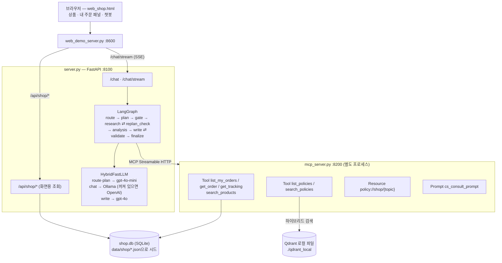

# 솔방울마켓 주문·배송 상담 에이전트

> SKALA AI Mini Project — 과제 2번(신규 프로젝트). 가상의 쇼핑몰 화면에서 오른쪽 아래 챗봇에
> "택배가 3일째 안 와요", "사이즈가 안 맞는데 반품돼요?"처럼 물으면, 에이전트가 **내 주문의 실제 값**과
> **쇼핑몰 정책 문서**를 찾아서 근거 있는 답을 한다. 챗봇은 **조회·안내만** 하고 신청은 대신하지 않는다.
>
> 장애 대응 에이전트의 뼈대(LangGraph·MCP·RAG·검증·평가)를 그대로 가져와 주제만 바꿨다.
> 장애 대응 버전(이전 과제)은 이 저장소에 포함하지 않았다.
> 솔방울마켓은 실존하지 않는 쇼핑몰이고, 상품·주문은 모두 목업 데이터다.

## 0. 한눈에 보기

| 구성 요소 | 하는 일 | 핵심 파일 |
|---|---|---|
| 목업 데이터 (단일 소스) | 목업 회원 2명·상품 10개·주문 9건(회원 1은 상태별 1건씩 6건)·정책 문서 8개. SQLite(`shop.db`)에 넣고 화면과 에이전트가 같은 저장소를 읽음 | `data/shop/`, `mcp_tools/shop.py`, `mcp_tools/shop_repo.py` |
| 목업 로그인 | 아이디·비밀번호 + 목업회원 1·2 바로 로그인 버튼. 세션 쿠키로 고객을 구분하고 화면·챗봇 모두 그 고객의 주문만 조회 | `server.py`, `web_shop.html` |
| MCP 서버 (별도 서비스) | 주문 조회 Tool 3개 + 상품 조회 Tool + 정책 검색 Tool 2개 + 정책 Resource + 상담 절차 Prompt | `mcp_server.py`, `sh/run_mcp.sh` |
| 상담 파이프라인 | route → plan → gate → research ⇄ replan_check → analysis → write ⇄ validate | `agent/graph.py`, `agent/planning.py` |
| 정책 검색 (RAG) | 키워드+벡터 하이브리드 검색(Qdrant, `text-embedding-3-large`), Qdrant 장애 시 키워드로 폴백, 점수 미달이면 질의를 바꿔 재검색 | `mcp_tools/policies.py`, `scripts/index_policies.py`, `scripts/compare_retrieval.py` |
| 규칙 검증 | 답변의 금액·기간·주문번호·날짜가 실제 사실에 있는지, 조회한 주문을 빠뜨리지 않았는지 코드로 검사 | `agent/validators.py`, `agent/facts.py` |
| LLM 하이브리드 | 잡담=Ollama(로컬, 과금 0) / 라우팅·계획=gpt-4o-mini / 답변 작성=gpt-4o | `agent/hybrid_llm.py`, `agent/prompts.py` |
| 쇼핑몰 화면 | 상품 그리드 + 내 주문 패널(상태 배지·배송 추적) + 우측 하단 챗봇 (Vue 3 CDN, 빌드 없음) | `web_shop.html`, `web_demo_server.py` |
| LangSmith 추적 | 질문 하나 = 트리 하나 (그래프 노드 · LLM 호출 · MCP 호출) | `@traceable` (`agent/`), `.env` |
| 평가·테스트 | 정답 기반 평가셋 25문항 + 검색 방식 비교용 dev 질문 30개 + 오프라인 단위 테스트 66개 | `eval/`, `tests/` |

### 구조



---

## 1. 실행 순서

```bash
# ① 의존성 (처음 한 번)
bash sh/setup_venv.sh

# ② 단위 테스트 — 외부 서비스·API 키 없이 오프라인으로
.venv/bin/python -m pytest -q
```

### 1-A. 과금 없이 화면부터 보기 (fake LLM)

```bash
bash sh/run_agent_fake.sh          # 에이전트 :8100 (MCP는 stdio로 직접 띄움, 정책 검색=keyword)
bash sh/run_frontend.sh            # (새 터미널) 쇼핑몰 화면 → http://localhost:8600
```

fake LLM은 첫 답변을 일부러 짧게 써서 **검수에서 반려되고 다시 쓰는 모습**을 보여준다.

### 1-B. 실제 구성 (Ollama + OpenAI, 과금 있음)

```bash
cp .env.example .env               # OPENAI_API_KEY, LangSmith 키 채우기
bash sh/index_policies.sh          # 정책 문서 8개 임베딩(text-embedding-3-large) → ./qdrant_local (Docker 불필요, 비용 아주 작음)
bash sh/run_mcp.sh                 # (새 터미널) MCP 서버 :8200 — qdrant_local이 있으면 하이브리드 검색 자동 사용
ollama serve                       # (새 터미널, 선택) 잡담용 로컬 모델. 꺼져 있으면 OpenAI로 폴백
bash sh/run_agent_hybrid.sh        # (새 터미널) 에이전트 :8100 — 과금 확인 프롬프트가 뜸
bash sh/run_frontend.sh            # (새 터미널) http://localhost:8600
```

- `index_policies.sh`는 MCP 서버를 띄우기 **전에** 실행한다. 로컬 파일 모드 Qdrant는 한 프로세스만 열 수 있다.
- 정책 문서를 고쳤으면 MCP 서버를 끄고 `index_policies.sh`를 다시 실행한다.
- `run_mcp.sh`, `run_agent_*.sh`, `run_frontend.sh`는 서버를 띄우는 명령이라 **끝나지 않고 계속 실행 중**인 게 정상이다. 각각 다른 터미널 탭에서 실행하고, 끝낼 때 Ctrl+C.
- 코드를 바꾼 뒤에는 MCP 서버 → 에이전트 순서로 다시 띄운다 (에이전트가 시작할 때 MCP에 연결하기 때문). 화면 서버는 그대로 두고 브라우저만 새로고침(Cmd+Shift+R).

### 화면에서 해볼 것

1. 내 주문 패널의 **ORD-1004(배송지연)** 카드에서 "이 주문 문의하기" → 주문번호가 입력창에 채워짐 → "택배가 3일째 안 와요"
2. 빠른 질문 칩 "환불 언제 돼요?" → 주문번호 없이도 반품 진행 중인 ORD-1006을 찾아서 환불 정책으로 답함
3. "반품 기간이 어떻게 돼요?" → 주문 조회 없이 정책만 찾음 (처리 과정에 "주문 조회 없이 진행 (일반 정책 질문…)")
4. "ORD-9999 어디쯤 왔어요?" → 없는 주문이라고 답함 (지어내지 않음)
5. "극세사 담요 얼마에요?" → 화면과 같은 24,900원과 색상 옵션으로 답함. "노트북 얼마에요?"처럼 없는 상품은 가격을 말하지 않음
6. 답변 아래 "처리 과정 N단계 보기"를 펼치면 어떤 주문·정책을 몇 점으로 골랐는지, 검수에서 왜 반려됐는지 보인다

---

## 2. 무엇을 어떻게 만들었나

### 2-1. 목업 데이터를 한 곳에 두고 화면과 에이전트가 같이 쓴다

**문제.** 화면에 "배송지연"으로 보이는 주문을 챗봇에 물었는데 챗봇이 다른 값을 말하면 데모 자체가 성립하지 않는다.

**바꾼 것.**
- `data/shop/`에 고객·상품·주문·정책을 둔다. 주문 6건은 상태를 하나씩 배치했다:
  결제완료(ORD-1001) / 배송준비중(1002) / 배송중(1003) / **배송지연(1004)** / 배송완료(1005) / 반품요청됨(1006)
- `mcp_tools/shop.py`의 `ShopStore` 한 클래스로 읽는다. 화면용 API(`server.py`의 `/api/shop/*`)와 MCP Tool(`get_order` 등)이 둘 다 이 클래스를 쓴다.
- **저장소와 판정 로직을 나눴다.** `ShopStore`는 지연·반품 기간 판정만 하고, 데이터는 `mcp_tools/shop_repo.py`의 Repository가 가져온다. 기본은 SQLite(`shop.db`, 스키마 `data/shop/schema.sql`)이고 처음 실행할 때 `data/shop/*.json`으로 자동 시드한다(`python scripts/seed_shop_db.py --reset`으로 다시 만들기). `SHOP_BACKEND=json`이면 JSON을 직접 읽는다. 실제 주문 DB·API로 바꿀 때는 Repository 구현만 하나 더 만들면 된다.
- **고객별로 나눈다.** 목업 회원 2명(김솔이 `sol`/`mock1234`, 박하늘 `haneul`/`mock5678`)이 있고, 모든 주문 조회에 `customer_id`가 붙는다. 로그인 세션에서 서버가 `customer_id`를 꺼내 MCP Tool에 넘기므로(LLM이 정하는 값이 아님) 회원 2가 회원 1의 주문번호를 물어도 "없는 주문"으로 답한다. 대화 이력도 고객별로 저장한다.
- **기준일(`as_of: 2026-10-20`)을 데이터 안에 고정**했다. "3일째 안 옴" 같은 경과일을 실제 오늘 날짜로 계산하면 평가를 다른 날 돌릴 때마다 정답이 바뀐다.
- 상태값만 믿지 않고 날짜로도 판정한다. 도착 예정일을 2일 이상 넘긴 미배송 주문은 `issue`에 "배송지연: 도착 예정일 …보다 3일 지남, 마지막 이동 … (3일째 이동 없음)"이 붙는다.

**확인.** `tests/test_shop_store.py` (지연 판정, 반품 마감일 계산, 없는/이상한 주문번호 처리, 고객별 분리, 로그인 — JSON·SQLite 두 저장소에서 같은 테스트), `tests/test_graph_flow.py` (회원 2가 회원 1의 주문을 물으면 '없음')

### 2-2. MCP 서버: Tool · Resource · Prompt

| 종류 | 이름 | 왜 이 종류인가 |
|---|---|---|
| Tool | `list_my_orders`, `get_order`, `get_tracking` | 주문 상태는 계속 바뀌는 동적 조회 |
| Tool | `search_products` | 상품 판매가·옵션 조회 — 화면과 같은 `products.json` |
| Tool | `list_policies`, `search_policies` | 질문과 가까운 문서를 '찾는' 동작 |
| Resource | `policy://shop/{topic}` | URI로 식별되는 정적 문서 본문 |
| Prompt | `cs_consult_prompt` | 상담 표준 절차(주문 확인 → 정책 확인 → 근거로만 안내)를 plan 단계에 깔아줌 |

- 에이전트는 tool·resource·prompt가 **어느 서버에 있는지 미리 가정하지 않고** `find_tool / find_resource_template / find_prompt`로 연결된 서버를 조회한 뒤 호출한다. 지금은 서버가 하나지만, 나중에 역할별로 나눠도(예: 상품 서버 분리) 에이전트 코드는 그대로다. (장애 대응 버전에 있던 탐색 시연용 decoy 서버는 쇼핑몰 주제와 관계가 없어서 삭제했다.)
- `MCP_TRANSPORT=http`면 미리 떠 있는 MCP 서버에 URL로 접속만 한다. 에이전트를 재시작해도 MCP는 그대로이고, 정책 검색 방식을 바꿔도 에이전트 코드는 그대로다.
- 에이전트(`agent/`)는 `mcp_tools/`를 import하지 않는다. 데이터는 MCP 결과(JSON)로만 받는다.

### 2-3. 상담 파이프라인 (`agent/graph.py`)

```
route ─ chat ──────────────────────────────────────────────→ 잡담 답변
      └ order → plan → gate → research ⇄ replan_check → analysis → write ⇄ validate → finalize
```

| 노드 | 하는 일 |
|---|---|
| route | 쇼핑 상담(order — 주문·배송·반품, 상품 가격·옵션 문의 포함)인지 잡담(chat)인지 분류. 잡담은 무거운 파이프라인을 타지 않는다 |
| plan | ① MCP `list_my_orders`로 고객 주문 목록을 받고 ② MCP Prompt로 상담 절차를 받고 ③ LLM이 대상 주문을 고른 뒤 ④ **코드가 보정**한다 (아래) |
| gate | `needs_analysis=false`인데 섞여 들어온 분석 task를 코드로 제거 (권위 게이트) |
| research | 주문 조회(get_order + get_tracking), 상품 조회(search_products), 정책 검색을 **병렬** 실행. task 하나가 실패해도 나머지는 계속(에러 격리), 일시 오류는 재시도 |
| replan_check | 조회한 주문마다(주문이 없으면 질문 1건) 유사도 임계치 이상인 정책 문서가 있는지 판정. 없으면 그 주문만 다시 검색 (최대 2라운드). 가격·옵션만 묻는 질문은 정책 없이 진행 |
| analysis | 여러 주문을 비교해야 할 때만 실행 (예: 신발·이어폰이 동시에 안 옴 → 같은 택배사 문제인가) |
| write | gpt-4o가 `1) 확인 내용 2) 안내 3) 다음 단계` 형식으로 답변 (주문 문의는 주문·정책, 상품 문의는 판매가·옵션). 토큰 단위로 화면에 스트리밍 |
| validate | 규칙 검사(2-5). 반려되면 반려 사유를 붙여 다시 쓴다 (최대 3회) |

**plan 코드 보정 (`agent/planning.py`).** LLM이 고른 주문을 그대로 믿지 않는다. 위에서부터 우선:
1. 질문에 주문번호가 있으면 그 주문 (목록에 없는 번호여도 조회해서 "없음"을 근거로 답하게 함)
2. LLM이 고른 주문 — **고객 목록에 실제로 있는 번호만** (지어낸 번호는 버림)
3. 상품명·카테고리 일치 ("이어폰 언제 와요?" → ORD-1003, "신발" → ORD-1004)
4. 질문 의도에 맞는 상태의 주문, 그중 문제 있는 주문 우선 ("택배가 안 와요" → 배송지연 ORD-1004)
5. 문제 있는 주문, 그것도 없으면 최근 주문
- "반품 기간이 어떻게 돼요?" 같은 **일반 정책 질문**은 주문을 조회하지 않고 정책만 찾는다.
- "극세사 담요 얼마에요?" 같은 **상품 문의**는 상품 조회 task를 만들고, 주문 얘기가 없으면 주문은 조회하지 않는다 (담요를 주문한 적이 있어도 '가격'을 물은 것이므로).
- 장애 대응 버전에서는 이 보정 코드가 LLM 파일 3개에 복붙돼 있었다. 한 곳으로 모아서 LLM 종류와 상관없이 같은 규칙이 적용되고 단위 테스트(`tests/test_planning.py`)도 된다.

### 2-4. 정책 검색 — 키워드+벡터 하이브리드 RAG (`mcp_tools/policies.py`)

**문제.** 고객은 정책 문서의 단어로 말하지 않는다. "데님 팬츠 박음질이 다 터져서 왔어요"에는 '하자', '불량' 같은 단어가 없다.

**바꾼 것.**
- 정책 문서 8개에 머리말(`topic, title, keywords`)을 달고, 문서 1개 = 청크 1개로 Qdrant에 넣는다 (문서가 5줄 안팎이라 쪼갤 이유가 없고, 고르는 단위도 문서다).
- `search_policies` (기본 `POLICY_SEARCH=hybrid`): 문서마다 **0.5 × 벡터 유사도 + 0.5 × 키워드 점수**로 순위를 매긴다. 벡터는 `text-embedding-3-large` 임베딩의 코사인 유사도, 키워드는 질문 단어가 문서 키워드·제목·본문에 나오는 비율이다. 벡터는 바꿔 말한 표현에, 키워드는 정책 용어를 그대로 쓴 질문에 강해서 서로 약점을 메운다.
- Qdrant가 없거나 비어 있으면 **키워드 검색으로 폴백**한다 (검색 품질은 떨어져도 상담은 계속된다). `POLICY_SEARCH=qdrant`(벡터만), `keyword`(키워드만)로 바꿔 비교할 수 있다.
- 검색 질의는 **사용자 질문 + 주문 상황**이다. 같은 "반품돼요?"라도 배송완료 주문과 반품 진행 중 주문은 필요한 정책이 다르다.
- 1등과 점수가 비슷한(90% 이상) 2등까지 가져온다. "사이즈가 안 맞는데 반품돼요?"에는 반품 정책과 사이즈 교환 정책이 둘 다 필요하다.
- 점수가 임계치(`POLICY_MIN_SCORE_HYBRID=0.15`) 미만이면 replan_check가 **상태별 표준 문구로 질의를 바꿔** 한 번 더 찾는다.
- 방식·비중·임계치는 평가셋이 아니라 **별도 dev 질문 30개**(`eval/retrieval_dev.json`)로 골랐다 (`scripts/compare_retrieval.py`, 결과 `eval/results/retrieval_dev.json`).
- Docker 없이 `QDRANT_PATH=./qdrant_local` 로컬 파일 모드로 돈다.

**확인.** `tests/test_policy_search.py` — in-memory Qdrant 인덱싱·검색, 하이브리드 점수 계산, Qdrant 장애 시 폴백, 그리고 키워드 검색이 "찢어져 있어요"를 0점으로 놓치는 한계를 테스트로 기록해 두었다.

**처음(1~3차)에는 `text-embedding-3-small` 벡터 검색만 썼는데**, 바꿔 말한 질문에서 키워드 검색보다 낮았다 (3-4절 ①). 그래서 4차에 하이브리드로 바꿨다 (3-4절 4차).

### 2-5. 규칙 검증 (`agent/validators.py`)

**문제.** 상담 답변에서 가장 위험한 건 "그럴듯하지만 틀린 값"이다. 없는 주문번호, 실제와 다른 도착일, 정책에 없는 "14일 이내 반품 가능"을 고객은 그대로 믿는다.

**바꾼 것.** LLM이 쓴 답을 코드가 한 번 더 검사한다 (비용 0, 결정론).

| 검사 | 내용 |
|---|---|
| format | 30자 이상 + `1)` 번호 형식 |
| numbers | 단위(원·일·영업일·시간·개·건·%)가 붙은 숫자가 수집된 사실(주문 + 정책 발췌)에 있는가. **정책 기간을 지어내면 여기서 걸린다** |
| order_ids | 답변의 주문번호가 실제로 조회한 주문인가 |
| dates | 답변의 날짜(10월 17일 / 2026-10-17 / 10/17)가 사실에 있는가 |
| coverage | 조회한 주문의 주문번호가 답변에 빠지지 않았나 |

- 작성자(LLM)가 본 사실과 검사 기준이 같은 텍스트여야 공정하므로, 사실 포맷팅을 `agent/facts.py` 한 곳에 모았다.
- 3번 모두 반려되면 마지막 초안 대신 **안전한 기본 답변**(확인된 주문번호·상태 + "정확한 기준은 고객센터로")을 내보낸다. LLM 없이 사실만으로 만들어 항상 검사를 통과한다.
- 정책 검색이 끝내 실패하면 사실 목록에 **"정책 문서를 찾지 못함 — 추측하지 말 것"**을 넣는다. 실측에서 지어낸 답은 전부 이 경로였고, 이 한 줄로 0건이 됐다 (3-4절 3차).
- `VALIDATION_MODE=basic`이면 format만 본다 → Before/After 비교용 스위치.
- LLM 심판을 쓰지 않은 이유: 정답이 있는 검사(숫자가 사실에 있나)를 LLM에 맡기면 비용이 들고 결과가 흔들린다.

**확인.** `tests/test_validators.py` — 지어낸 주문번호·날짜·금액을 각각 잡는지, basic 모드에서는 그대로 통과하는지.

### 2-6. LLM 하이브리드 (`LLM_BACKEND=hybrid`)

| 작업 | 모델 | 이유 |
|---|---|---|
| route, plan, analyze | gpt-4o-mini | 판단이 틀리면 파이프라인 전체가 틀어진다. 짧은 JSON 출력이라 저렴 |
| chat (잡담) | Ollama qwen3:8b (로컬) | 빈도가 높고 틀려도 피해가 작다. 과금 0. **꺼져 있으면 OpenAI로 폴백** |
| write (상담 답변) | gpt-4o | 고객이 실제로 읽는 문장 |

- 프롬프트와 JSON 파싱은 `agent/prompts.py` 한 곳에 두고 OpenAI·Ollama가 같이 쓴다.
- Ollama는 `think: false`로 호출한다 — qwen3의 '생각' 토큰 때문에 잡담 응답이 10~20초 걸리던 것을 1차 측정에서 발견했다.
- 실측: 잡담 비용은 절반이 됐지만 응답은 약 2배 느렸다 (3-4절 ③).
- 답변(write·chat)은 OpenAI도 `stream=True`로 받아서 화면에 타이핑되듯 나온다.
- `graph.py`는 어떤 LLM이 꽂혀 있는지 모른다 — `SupervisorDeps`로 주입받는다 (의존성 주입). 그래서 테스트에서는 fake LLM·fake MCP를 꽂아 서버 없이 그래프 전체를 돌린다.

### 2-7. 쇼핑몰 화면 (`web_shop.html`)

- 헤더 · 상품 그리드 · **내 주문/배송 패널**(상태 배지, 문제 표시, 배송 추적 타임라인) · **우측 하단 챗봇 버튼**
- 주문 카드의 "이 주문 문의하기" → 주문번호가 입력창에 채워진 채로 챗봇이 열린다. 빠른 질문 칩 4개
- 챗봇은 `/chat/stream`(SSE)으로 단계 이벤트를 받아 "처리 과정"으로 보여주고, 답이 나오면 접는다
- 검수에서 반려된 초안은 취소선으로 남기고 "검수에서 반려된 초안 — 다시 작성합니다"를 표시한다 (validate가 실제로 일하는 게 보이게)
- "답변 근거(LLM에 전달된 사실) 보기"로 작성자가 받은 사실을 펼쳐 볼 수 있다
- 모바일 폭(560px 이하)에서는 챗봇이 화면 전체를 덮는다. 시스템 다크 모드를 따른다

### 2-8. LangSmith 추적

- `.env`의 `LANGCHAIN_TRACING_V2=true`와 `LANGCHAIN_API_KEY`가 있으면 켜진다.
- 질문 하나가 `chat_request` 아래 트리 하나로 남는다: 그래프 노드(route → plan → … → validate), LLM 호출(프롬프트·응답·토큰), MCP 호출(주문·상품 조회, 정책 검색, 재시도). 각 함수의 `@traceable`이 기록한다.
- MCP 서버 내부(검색 점수 계산 등)는 별도 프로세스라 트리에 들어가지 않고, MCP 호출의 응답으로만 보인다.
- 실행 방식별로 프로젝트를 나눈다:

| 실행 | LangSmith 프로젝트 |
|---|---|
| `sh/run_agent_hybrid.sh` | `shop-cs-agent-hybrid` |
| `sh/run_agent_openai.sh` / `run_agent_ollma.sh` / `run_agent_fake.sh` | `shop-cs-agent-openai` / `-ollama` / `-fake` |
| 2026-10-20 Before/After 측정 | `shop-cs-agent-eval` |

---

## 3. 평가와 Before/After

### 3-1. 단위 테스트 (`tests/`, 오프라인)

```bash
.venv/bin/python -m pytest -q
```

| 파일 | 확인하는 것 |
|---|---|
| `test_shop_store.py` | 지연 판정, 반품 마감일, 추적 경과일, 주문번호 검증, 상품 검색, 고객별 분리, 로그인 (JSON·SQLite 두 저장소) |
| `test_planning.py` | plan 보정 규칙 ①~⑤, 일반 질문, 상품 문의, 지어낸 주문번호 제거, 1차 측정 회귀(LLM의 '일반 질문' 판단보다 문제 주문 우선) |
| `test_policy_search.py` | 카탈로그, 키워드 검색, in-memory Qdrant, 하이브리드 점수, Qdrant 장애 폴백, 키워드 검색의 한계 |
| `test_validators.py` | 5가지 검사, basic 모드, 정책 없음 명시, 기간 vs 날짜 구분, 틀린 상품 가격 반려 |
| `test_graph_flow.py` | 그래프 전체 (fake LLM + fake MCP): 주문 찾기, 일반 질문, 없는 주문, 재검색 라운드, 에러 격리, 게이트, 검수 반려 후 재작성, 3회 실패 시 안전 답변, 가격 질문 |
| `test_hybrid_llm.py` | 작업별 LLM 분배, Ollama 장애 시 폴백 |

### 3-2. 정답 기반 평가 (`eval/`)

`eval/dataset.json` 25문항 — 배송 지연, 반품 가능 여부, 환불 시점, 배송지 변경, 취소, 하자, 일반 정책 질문 3개, 없는 주문번호, 복수 주문 비교, 잡담, 이름 기억(s01~s15) + **바꿔 말한 질문 7개**(s16~s22, 정책 문서의 키워드를 일부러 피해서 씀. 예: "돈은 언제 돌려받을 수 있나요?", "신발 밑창이 떨어진 채로 왔어요") + **상품 가격 문의 3개**(s23~s25, 1~4차 측정 이후 추가).
각 문항에 정답(조회해야 할 주문, 가져와야 할 정책, 답변에 들어가야 할 값)이 있다. 에이전트를 HTTP로만 부르므로 **설정만 바꾼 서버**를 같은 스크립트로 잰다. LLM 심판은 쓰지 않는다.

| 지표 | 의미 |
|---|---|
| route_acc | 라우팅 정답률 |
| order_recall / order_precision | 조회해야 할 주문을 찾았나 / 엉뚱한 주문을 끌어오지 않았나 |
| policy_recall | 필요한 정책 문서를 가져왔나 (**검색 비교의 핵심**) |
| policy_recall_para | 위 지표를 바꿔 말한 질문 7개로만 계산 |
| grounded | 답변의 금액·기간·주문번호·날짜가 전부 사실에 있는 답변 비율 (**검증 비교의 핵심**) |
| value_coverage | 답변에 꼭 나와야 할 값이 나왔나 |
| memory_ok, validation_tries, latency_s, cost_usd | 기억, 검수 시도 횟수, 지연(초), 비용 |

`cost_usd`는 실제 청구 금액이 아니라 **실측 토큰 수 × 가상 단가**(gpt-4o-mini $0.00015/1K, gpt-4o $0.005/1K, Ollama 0)다. 백엔드끼리 같은 잣대로 비교하기 위한 값이다.

### 3-3. Before/After 측정 방법 (실제 OpenAI, 과금 있음)

비교는 장애 대응 버전과 하는 게 아니라 **이 주제 안에서 한 가지 설정만 바꿔서** 한다.
After는 세 비교 모두 같은 설정(RAG + 규칙 검사 + 하이브리드)이라 한 번(`full`)만 돌려서 함께 쓴다.

| 실행 | 정책 검색 (MCP) | LLM | 검증 |
|---|---|---|---|
| `full` (After) | qdrant (4차: hybrid) | hybrid | rules |
| `search_keyword` (① Before) | **keyword** | hybrid | rules |
| `validate_basic` (② Before) | qdrant (4차: hybrid) | hybrid | **basic** |
| `llm_openai` (③ Before) | qdrant (4차: hybrid) | **openai** | rules |

표의 "qdrant"는 1~3차의 `text-embedding-3-small` 벡터 검색이다. 지금 기본값은 hybrid라서 지금 `run_mcp.sh`로 띄우면 4차 설정이 된다.

```bash
# 예: ① Before — MCP를 키워드 검색으로, 에이전트는 하이브리드로 띄우고 평가
POLICY_SEARCH=keyword bash sh/run_mcp.sh                 # 터미널 1
bash sh/run_agent_hybrid.sh                               # 터미널 2
.venv/bin/python eval/run_eval.py --label search_keyword  # 터미널 3
# ② Before: VALIDATION_MODE=basic bash sh/run_agent_hybrid.sh
# ③ Before: LLM_BACKEND=openai MCP_TRANSPORT=http .venv/bin/python server.py
# After  : bash sh/run_mcp.sh (qdrant_local 자동 사용) + bash sh/run_agent_hybrid.sh → --label full

.venv/bin/python eval/run_eval.py --compare eval/results/search_keyword.json eval/results/full.json
```

하이브리드 실행 전에는 Ollama에 요청을 한 번 보내 모델을 메모리에 올려 둔다 (첫 호출의 모델 로딩 시간이 지연 비교를 왜곡하지 않게).

### 3-4. 결과

2026-10-20 측정. 모델: gpt-4o-mini(route·plan), gpt-4o(write), qwen3:8b(Ollama, 잡담), 정책 검색 임베딩은 1~3차 text-embedding-3-small, 4차 text-embedding-3-large.
**설정마다 1회씩 실행**한 값이라 문항 1~2개의 변동으로 수치가 흔들릴 수 있다 (아래 한계 참고).
결과 원본: `eval/results/round1~round4/`(1~4차, 4차는 `full`만), `eval/results/retrieval_dev.json`(검색 방식 비교).

#### 1차 측정 (15문항) — 개선 효과가 거의 안 보였다

| 비교 | 지표 | Before | After |
|---|---|---|---|
| ① 키워드 → RAG | policy_recall | 0.917 | 0.917 |
| ② 형식만 → 규칙 검사 | grounded | 1.0 | 1.0 |
| ③ OpenAI → 하이브리드 | 문항 평균 latency_s | 4.46 | 6.25 |
| ③ OpenAI → 하이브리드 | 잡담 응답 시간 (s14 / s15) | 1.8 / 3.7초 | 10.2 / 20.0초 |

수치보다 **문항별 로그에서 찾은 문제**가 더 중요했다.

| # | 발견한 문제 | 원인 | 수정 |
|---|---|---|---|
| 1 | "환불 언제 돼요?"에 반품 진행 중인 ORD-1006을 4번 실행 모두 조회하지 않음 | gpt-4o-mini가 일반 질문(`needs_order=false`)으로 분류했고, 코드가 그 판단을 보정 규칙보다 먼저 믿음 | 상품명 일치·의도에 맞는 문제 주문이 있으면 코드가 우선 (`agent/planning.py`) |
| 2 | 일반 정책 질문 3개가 매번 검수에 2번 반려된 뒤 3회째 강제 통과 | 주문이 없으면 gpt-4o가 "1)"을 건너뛰고 "2)"부터 씀 → 형식 검사 반려. 질문마다 gpt-4o를 2번씩 헛되이 더 부름 | 작성 프롬프트에 "주문이 없으면 1)에 '특정 주문 없이 안내'라고 쓴다" 추가 |
| 3 | 하이브리드의 잡담 응답이 10~20초 | qwen3가 답하기 전에 '생각' 토큰을 생성 | Ollama 호출에 `think: false` (같은 인사 응답 5.8초 → 1.5초) |
| 4 | 키워드 vs RAG 차이가 0 | 정책 문서 키워드를 쓸 때 평가 질문과 같은 단어를 넣어서, 평가셋이 키워드 검색에 유리했음 | 키워드를 피한 '바꿔 말한 질문' 7개 추가 |

수정 효과 (After 설정 `full`, 1차 → 2차):

| 지표 | 1차 | 2차 |
|---|---|---|
| order_recall | 0.9 | **1.0** |
| 일반 정책 질문의 검수 시도 횟수 (s08 / s12 / s13) | 3 / 3 / 3 | **1 / 1 / 1** |
| 잡담 응답 시간 (s14 / s15) | 10.2 / 20.0초 | **3.2 / 6.1초** |
| 문항 평균 latency_s | 6.25 | **4.82** |

#### 2차 측정 (22문항)

| 비교 | 지표 | Before | After | 해석 |
|---|---|---|---|---|
| ① 키워드 → RAG | policy_recall (전체) | **0.789** | 0.684 | RAG가 더 낮음 |
| ① 키워드 → RAG | policy_recall_para (바꿔 말한 7개) | **0.571** | 0.286 | RAG가 더 낮음 |
| ② 형식만 → 규칙 검사 | grounded (주문 상담 20개) | 0.80 | **0.90** | 지어낸 값이 있는 답변 4개 → 2개 |
| ② 형식만 → 규칙 검사 | validation_tries | 1.0 | 1.4 | 반려 후 재작성 |
| ② 형식만 → 규칙 검사 | cost_usd (문항 평균) | 0.00348 | 0.00420 | +21% |
| ③ OpenAI → 하이브리드 | 잡담 비용 (s14+s15) | 0.000140 | **0.000072** | −49% |
| ③ OpenAI → 하이브리드 | 잡담 응답 시간 (s14 / s15) | **1.7 / 3.4초** | 3.2 / 6.1초 | 약 2배 느림 |
| ③ OpenAI → 하이브리드 | 문항 평균 latency_s | 4.65 | 4.82 | |

**① RAG가 키워드 검색보다 못했다.**
- `text-embedding-3-small`은 한국어 구어체를 잘 구분하지 못했다. 바꿔 말한 질문에서 모든 정책의 점수가 0.1~0.3에 몰리고, 정답 정책이 3~5위였다 (예: "돈은 언제 돌려받을 수 있나요?" → refund 3위, 1위는 배송 지연).
- 그래서 임계치(0.4)를 넘는 문서가 없어 **정책 없이 답을 쓰는 경우**가 5건(s09, s16, s17, s19, s22) 생겼다.
- 키워드 검색은 임계치가 낮고(0.3) 접두 일치라 '어쨌든 무언가'를 가져와서 점수가 높게 나온 면도 있다 (s17·s22는 키워드도 틀린 문서를 가져옴).
- 추가 실험: `text-embedding-3-large`로 다시 인덱싱하자 바꿔 말한 7개 중 **5개에서 정답이 1위**가 됐다. 하지만 점수 자체가 0.25~0.42로 낮아서 관련 없는 질문("오늘 날씨" 0.23)과 고정 임계치로 가르기 어렵다. → 4차에서 키워드 점수와 섞는 하이브리드로 반영했다.

**② 규칙 검사는 효과가 있었지만, 마지막 방어선에 구멍이 있다.**
- 지어낸 값이 있는 답변 4건은 **전부 정책 문서를 못 가져온 문항**에서 나왔다. 정책이 없으니 gpt-4o가 "환불은 영업일 기준 7일 이내"(실제 정책은 3영업일)처럼 그럴듯한 기간을 지어냈다.
- 규칙 검사가 4건을 모두 반려했고, 그중 2건은 재작성으로 고쳐졌다.
- 나머지 2건(s16, s19)은 3번 연속 반려된 뒤 '최대 시도 도달 → 통과 처리' 규칙 때문에 **틀린 답이 그대로 고객에게 나갔다**.
- 대가: 검수 시도 1.0 → 1.4회, 비용 +21%.

**③ 하이브리드는 잡담 비용을 절반으로 줄였지만, 절대 금액이 작고 응답이 느려졌다.**
- 잡담은 gpt-4o-mini로도 질문당 $0.00005 수준이라 Ollama로 옮겨도 아끼는 금액이 아주 작다.
- 전체 비용은 gpt-4o 답변 작성이 대부분을 차지한다. 그래서 문항 평균 비용은 검수 재작성 횟수 차이(1.2 vs 1.4회)에 더 크게 흔들렸다.
- 이 PC(Apple Silicon)에서는 로컬 모델이 약 2배 느렸다. 잡담 트래픽이 아주 많거나 데이터를 외부로 보내면 안 되는 경우가 아니면 이득이 작다.


#### 3차 측정 (22문항) — 2차에서 찾은 구멍을 막은 뒤

2차 분석에서 고친 것:

| # | 2차에서 확인한 문제 | 수정 |
|---|---|---|
| 5 | 정책을 못 찾으면 gpt-4o가 기준을 지어냄 (지어낸 값 4건 전부 이 경로) | 정책 검색이 끝내 실패하면 사실 목록에 "이 문의에 맞는 정책 문서를 찾지 못함 — 추측하지 말 것"을 넣고, 작성 프롬프트에 "그 경우 고객센터로 안내"를 추가 (`agent/facts.py`) |
| 6 | 검수 3회 반려 후 '통과 처리'로 틀린 답이 고객에게 나감 | 마지막 초안 대신 LLM 없이 사실(주문번호·상태)만으로 만든 **안전한 기본 답변**으로 대체 (`facts.safe_answer`, `validate_node`) |
| 7 | (테스트 중 발견) "14일 이내"가 회수일 2026-10-**14**의 14 때문에 수치 검사를 통과 | '일' 단위는 기간 표현(N일 이내·째·후, N영업일)이면 사실 속 '기간' 숫자와만 비교 (`agent/validators.py`) |

7번 때문에 3차는 채점 기준(grounded)도 더 엄격하다. 2차 결과 파일에는 다시 채점할 프롬프트가 없어서 2차 값을 새 기준으로 다시 매기지는 못했다 (3차부터는 결과 파일에 프롬프트를 함께 저장한다).

| 비교 | 지표 | Before | After | 해석 |
|---|---|---|---|---|
| ① 키워드 → RAG | policy_recall (전체) | **0.789** | 0.684 | 2차와 같음 (검색은 결정론) |
| ① 키워드 → RAG | policy_recall_para | **0.571** | 0.286 | 2차와 같음 |
| ① 키워드 → RAG | "정책 못 찾음 → 고객센터" 답변 수 (주문 상담 20개 중) | 0 | 5 | RAG는 모르면 모른다고 함 |
| ② 형식만 → 규칙 검사 | grounded | 1.0 | 1.0 | 둘 다 지어낸 값 0건 |
| ② 형식만 → 규칙 검사 | validation_tries · cost_usd | 1.0 · 0.003715 | 1.0 · 0.003723 | 추가 비용 거의 0 |
| ② 형식만 → 규칙 검사 | safe_fallback | – | 0.0 | 안전 답변으로 대체된 답 0건 |
| ③ OpenAI → 하이브리드 | 잡담 비용 (s14+s15) | 0.000141 | **0.000072** | −49% |
| ③ OpenAI → 하이브리드 | 잡담 응답 시간 (s14 / s15) | **1.8 / 3.8초** | 3.7 / 6.4초 | 약 2배 느림 |

**가장 큰 효과는 검증 규칙이 아니라 "정책이 없다는 사실을 알려준 것"(5번)에서 나왔다.**

| 설정 `validate_basic` (검증 끔) | 2차 | 3차 (더 엄격한 채점) |
|---|---|---|
| grounded | 0.80 (지어낸 답 4건) | **1.0 (0건)** |

- 검증을 꺼둔 설정에서도 지어낸 답이 4건에서 0건이 됐다. gpt-4o는 "정책 없음"을 명시하면 추측하지 않았다. 문제를 뒤에서 잡는 것보다 **원인(빈 사실)을 앞에서 막는 게** 더 효과적이었다.
- 그래서 이번 측정에서는 규칙 검사(②)와 안전 답변(6번)이 할 일이 없었다 (반려 0건, 대체 0건). 두 장치는 모델·프롬프트가 바뀌어도 틀린 값이 나가지 않게 하는 **안전망**으로 남긴다. 동작은 단위 테스트로 확인한다 (`test_three_failed_checks_fall_back_to_safe_answer`, `test_day_span_must_match_a_span_not_a_date`). 비용은 거의 없다.
- 대가: RAG 설정에서는 주문 상담 20개 중 5개(바꿔 말한 질문 4개 + 없는 주문번호 1개)가 "정확한 기준은 고객센터로"라는 답이 됐다. 틀리지는 않지만 도움도 덜 된다. 남은 핵심 과제는 검색 품질이다 (①).
- 키워드 검색은 항상 뭔가를 가져와서 "모름" 답변이 0개였다. 엉뚱한 문서를 가져온 경우도 있었는데, 운 좋게 도움이 되기도 했다. 예: "받은 물건이 고른 거랑 달라요"에 일반 반품 정책을 가져왔는데, 그 문서에 "오배송은 배송비 판매자 부담" 문장이 있었다. 검증 규칙은 '사실에 있는 값인가'만 보므로 **엉뚱한 정책을 근거로 한 답**은 잡지 못한다.

#### 사용 중 발견: 화면과 다른 가격을 말하던 문제

화면에서 "극세사 담요 얼마에요?"라고 물었더니 챗봇이 **29,900원**이라고 답했다 (화면·데이터는 24,900원). 핸드크림도 15,900원 → 12,900원.

| 원인 | 수정 |
|---|---|
| 가격 질문이 주문 상담이 아니라 잡담(chat)으로 분류됨 | 라우터·plan이 가격·옵션·재고 질문을 상담 경로로 보냄 (`PRODUCT_PATTERN`, `needs_product`) |
| 잡담 경로에는 상품 데이터가 없어서 모델이 가격을 지어냄 | MCP Tool `search_products` 추가 — 화면과 같은 `products.json`의 판매가·옵션을 사실로 넣음. 잡담 프롬프트에도 "가격 추측 금지" |
| 잡담 경로는 검증을 거치지 않음 | 가격 질문이 상담 경로로 오면서 금액 검사가 적용됨 — 다른 가격을 쓰면 반려 (`test_wrong_product_price_is_rejected`) |

수정 후 실제 모델(gpt-4o-mini + gpt-4o)로 확인: "극세사 담요 얼마에요?" → 24,900원과 색상 옵션, "핸드크림 가격" → 15,900원, 없는 상품("노트북") → 가격을 말하지 않고 "정보를 찾을 수 없다"고 답함. 평가셋에 가격 문항 3개(s23~s25)를 추가했다 (전체 평가는 다시 돌리지 않음).

> **4차 (하이브리드 검색, After 설정만 측정):** 정책 검색을 키워드+벡터 하이브리드(`text-embedding-3-large`, 비중 0.5, 임계치 0.15)로 바꿨다 — 평가셋과 겹치지 않는 dev 질문 30개(`eval/retrieval_dev.json`)에서 정확도 0.567(벡터 small) → 0.800, 에이전트 전체 평가는 After 설정(`full`)만 1회 돌렸다: policy_recall 0.684 → **0.789**, 바꿔 말한 질문 0.286 → **0.571**, grounded 1.0 (`eval/results/round4/full.json`, 비교 설정은 다시 재지 않음, `scripts/compare_retrieval.py`).

---

## 4. 한계와 트레이드오프

- **검색이 약하면 답이 '모름'이 된다.** 정책을 못 찾았을 때 지어내는 문제(2차)는 3차에서 막았지만, 그 대신 RAG 설정에서 주문 상담 4개 중 1개꼴로 "고객센터로 문의"가 됐다. 정확하지만 덜 유용하다. 근본 해결은 검색 품질이다.
- **엉뚱한 정책을 근거로 한 답은 못 잡는다.** 검증 규칙은 '답의 값이 사실에 있는가'만 본다. 검색이 다른 문서를 가져오면 그 문서의 값으로 '근거 있는 오답'을 쓸 수 있다.
- **검색은 아직 완벽하지 않다.** 하이브리드로 바꿔 바꿔 말한 질문 적중률이 0.286 → 0.571이 됐지만 7개 중 3개는 여전히 놓친다 (예: "받은 물건이 고른 거랑 달라요" → 하자 정책이 3위). 관련 없는 질문 6개 중 3개("회원 등급" 등)에도 정책을 가져온다. 다음 후보: 문서가 8개뿐이니 LLM이 카탈로그에서 직접 고르게 하는 방법.
- **평가 데이터의 결함.** s21("신발 밑창이 떨어진 채로 왔어요")은 신발 주문(ORD-1004)이 아직 배송 전이라, 두 설정 모두 배송 지연으로 답했다. 하자 질문용으로는 배송 완료된 신발 주문이 필요했다.
- **측정 횟수와 과적합.** 설정마다 1회, 22문항이라 1~2문항의 변동이 지표를 0.05~0.1씩 움직인다. 2등 문서 비율(0.9)과 일반 질문 패턴은 1차 측정 질문을 보면서 정했다. 하이브리드의 비중·임계치는 평가셋과 겹치지 않는 dev 질문으로 골랐다. 4차는 After 설정만 측정했고 비교 설정은 다시 재지 않았다.
- **목업 데이터.** 회원 2명·주문 9건이라 "주문을 찾는" 문제가 실제보다 쉽다. 실제 주문 DB로 바꿀 때는 `shop_repo.py`에 Repository 구현만 추가하면 되고 MCP Tool 스키마와 에이전트는 그대로다.
- **목업 로그인.** 세션은 서버 메모리에 있어서 재시작하면 다시 로그인해야 하고, 고객 식별은 MCP Tool 인자(`customer_id`)로 넘긴다. 실서비스라면 세션은 공유 저장소에, 고객 식별은 MCP 요청의 인증 토큰에 둔다.
- **조회·안내만.** 반품·취소·배송지 변경 '접수'는 하지 않는다. 접수까지 하려면 사용자 승인(Human-in-the-loop) 단계와 쓰기 Tool이 필요하다 (과제 PDF 개선 예시 4번).
- **검증의 범위.** 숫자·주문번호·날짜는 잡지만, 숫자 없이 틀린 문장("반품이 불가능합니다")은 못 잡는다. 또 '3~5영업일'의 앞쪽 3처럼 범위 표기 일부는 검사하지 않는다.
- **키워드 폴백의 품질.** Qdrant가 죽어도 상담은 계속되지만, 형태소 분석기 없이 접두 일치로 조사만 흡수한다.
- **로컬 Qdrant는 한 프로세스만.** 로컬 파일 모드는 인덱싱과 MCP 서버를 동시에 열 수 없다. 여러 서버가 같이 쓰려면 Qdrant 서버(docker)로 바꾼다 (`QDRANT_URL`).
- **fake 모드의 한계.** fake LLM은 규칙 폴백만 쓰므로 정규식에 없는 표현은 잡담으로 분류된다. Before/After 수치는 반드시 실제 LLM으로 잰다.

---

## 5. 소스 구조

```
agent/
  graph.py         LangGraph 노드 · 엣지 (상담 파이프라인)
  planning.py      plan 코드 보정 규칙, 쇼핑 상담 판별 패턴
  prompts.py       OpenAI·Ollama 공용 프롬프트와 JSON 파싱
  facts.py         '수집된 사실' 텍스트 (write와 validate가 같이 씀)
  validators.py    규칙 검증 5종
  openai_llm.py · ollama_llm.py · hybrid_llm.py · fake_llm.py   LLM 백엔드
  mcp_client.py    MCP 클라이언트 (stdio/http, 서버 탐색)
  deps.py · retry.py · session_store.py · supervisor_v1.py
mcp_server.py      MCP 서버 (Tool · Resource · Prompt)
mcp_tools/
  shop.py          주문 조회 서비스 — 지연·반품 판정 (MCP Tool과 화면 API가 같이 씀)
  shop_repo.py     저장소 (SQLite 기본 | JSON) — 고객별 조회, 시드
  policies.py      정책 문서 카탈로그 + 검색 (hybrid | qdrant | keyword)
  embeddings.py    임베딩 (openai text-embedding-3-large | fake)
data/shop/         customers.json · products.json · orders.json (시드 원본) · schema.sql · policies/*.md
server.py          FastAPI 에이전트 :8100 (/chat, /chat/stream, /api/shop/*, /api/auth/*)
web_shop.html      쇼핑몰 화면 + 챗봇 (Vue 3 CDN)
web_demo_server.py 화면 서버 :8600 (백엔드 프록시)
scripts/
  index_policies.py     정책 문서 인덱싱 (Qdrant 로컬 파일 ./qdrant_local)
  seed_shop_db.py       쇼핑몰 SQLite DB 만들기 (data/shop/*.json → shop.db)
  compare_retrieval.py  검색 방식 비교 (dev 질문으로 방식·임계치 선택)
eval/
  dataset.json          평가셋 25문항
  retrieval_dev.json    검색 방식 선택용 dev 질문 30개
  run_eval.py · common.py   평가 실행·채점
  results/              round1~round4 측정 결과, retrieval_dev.json
tests/             단위 테스트 66개 (오프라인)
sh/                setup_venv · setup_ollama · index_policies · run_mcp · run_agent_{fake,hybrid,openai,ollma} · run_frontend · make_student_zip
doc/
  README.md             이 문서
```

---

## 6. Google Spread 제출용 계획 항목

- 가상 쇼핑몰 주문·배송 상담 에이전트로 주제 전환 (조회·안내 전용)
- 목업 주문·상품 데이터를 한 곳에 두고 화면과 에이전트가 같은 값을 쓰도록 구성
- MCP 서버를 별도 서비스로 분리 (주문·상품 조회 Tool, 정책 검색 Tool, 정책 Resource, 상담 절차 Prompt)
- 키워드+벡터 하이브리드 RAG로 정책 문서 검색 (Qdrant, 점수 미달 시 질의 변경 재검색, 장애 시 키워드 폴백)
- 상품 가격·옵션을 화면과 같은 데이터에서 조회해 가격을 지어내지 않게 함
- LLM 계획 결과를 코드로 보정 (지어낸 주문번호 제거, 상품명·질문 의도로 주문 찾기)
- 답변의 금액·기간·주문번호·날짜를 코드로 검증하고 반려 시 재작성, 3회 실패 시 안전한 기본 답변으로 대체
- 정책을 못 찾으면 그 사실을 작성 모델에 명시해 기준을 지어내지 않게 함 (지어낸 답 4건 → 0건)
- 작업별 LLM 분리 (잡담=Ollama, 계획=gpt-4o-mini, 답변=gpt-4o)
- 쇼핑몰 화면 + 우측 하단 챗봇 (SSE 스트리밍, 처리 과정 표시)
- 정답 기반 평가셋으로 키워드 vs RAG, 검증 전후, 단일 vs 하이브리드 LLM 비교
- LangSmith로 노드·LLM·MCP 호출 추적
- 오프라인 단위 테스트 (그래프 전체를 fake LLM·fake MCP로 검증)
