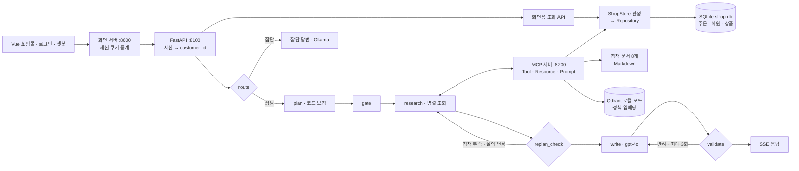

# 최종 보고서 — 쇼핑몰 주문·배송 상담 에이전트

| 항목 | 내용 |
|---|---|
| 소속 | SKALA 광주 2반 |
| 고유번호 · 이름 | G063 정구현 |
| 과제 | SKALA AI Mini Project — 과제 2 (신규 프로젝트), 개인 프로젝트 |
| 제출일 | 2026. 10. 22 |
| 저장소 | https://github.com/Hankookiniayo/ai_mini_project |

> 가상 쇼핑몰 '솔방울마켓'의 주문·배송 상담 챗봇이다. 고객이 "택배가 3일째 안 와요"라고 물으면 에이전트가 **내 주문의 실제 값**과 **쇼핑몰 정책 문서**를 찾아 근거 있는 답만 하고, 근거가 없으면 고객센터로 안내한다. 조회·안내만 하며 반품·취소 접수는 하지 않는다. 상품·주문·회원은 모두 목업 데이터다.

---

## 1. 문제 개선 및 신규 구현 사항

### 1.1 기존 시스템의 문제점과 해결 과제

**출발점.** 이전 과제인 장애 대응 에이전트의 구조(FastAPI · Vue · LangGraph · MCP · RAG · 검증)를 가져와 쇼핑몰 상담이라는 새 주제로 옮겼다.

**핵심 문제: LLM만으로 만든 상담 챗봇은 그럴듯한 값을 지어낸다.** 원인은 세 가지다.
- 내 주문(주문번호·배송 상태·도착 예정일)을 모른다.
- 쇼핑몰 정책(반품 기간·환불 시점·배송비)을 모른다.
- 모르면 지어내고, 고객은 그 값을 그대로 믿는다.

개발 중 실제로 나온 답변 두 가지가 이 문제를 보여준다.

| 질문 | 챗봇의 답 | 실제 |
|---|---|---|
| 극세사 담요 얼마에요? | 29,900원입니다 | 판매가 24,900원 |
| 돈은 언제 돌려받을 수 있나요? | 영업일 기준 7일 이내에 처리됩니다 | 정책: 검수 후 3영업일 |

**측정하며 찾은 구체적인 문제와 해결 과제.**

| 문제 | 해결 과제 |
|---|---|
| LLM이 "환불 언제 돼요?"를 일반 질문으로 분류해, 반품 중인 주문을 4번 실행 모두 조회하지 않음 | LLM이 고른 주문을 코드로 보정해야 한다 |
| 고객은 정책 문서의 단어로 말하지 않음("박음질이 다 터져서 왔어요"). 키워드 검색은 놓치고, small 임베딩은 정답이 3~5위 | 의미 기반 검색과 키워드 검색을 함께 써야 한다 |
| 정책을 못 찾으면 기간을 지어냄(4건). 3회 반려 뒤 '통과 처리'로 틀린 답 2건이 그대로 나감 | 근거가 없다는 사실을 모델에게 알리고, 답변 속 값을 코드로 검증해야 한다 |
| 가격 질문이 잡담으로 분류돼 가격을 지어냄 | 상품 데이터를 조회하는 Tool과 검증 경로가 필요하다 |
| 주문 데이터가 JSON 파일에 고객 1명. 실서비스라면 회원마다 자기 주문만 보여야 함 | 저장소를 분리하고, 회원별로 조회를 제한해야 한다 |

### 1.2 구현·개선한 핵심 기능

1. **주문 자동 식별과 코드 보정:** 로그인한 회원의 주문 목록 안에서 LLM이 대상 주문을 고르고, 코드가 5단계 규칙으로 보정한다. 지어낸 주문번호는 버린다.
2. **MCP 기반 조회 서비스:** 주문·배송·상품 조회 Tool, 정책 검색 Tool, 정책 Resource, 상담 절차 Prompt를 별도 프로세스(MCP 서버)로 분리했다.
3. **하이브리드 RAG 정책 검색:** text-embedding-3-large 벡터 점수와 키워드 점수를 섞고, 점수가 낮으면 질의를 바꿔 재검색한다.
4. **답변 근거 검증:** 금액·기간·주문번호·날짜가 수집된 사실에 있는지 코드로 검사한다. 반려되면 다시 쓰고, 3회 실패하면 안전한 기본 답변으로 바꾼다. 정책을 못 찾으면 "추측 금지"를 명시해 고객센터로 안내한다.
5. **작업별 LLM 분리:** 잡담은 로컬 Ollama(qwen3:8b), 분류·계획은 gpt-4o-mini, 상담 답변은 gpt-4o가 맡는다.
6. **SQLite 저장소와 목업 로그인:** 주문·회원·상품을 SQLite에 두고 Repository 계층으로 접근한다. 회원 2명으로 로그인하면 화면과 챗봇 모두 본인 주문만 조회한다.
7. **쇼핑몰 화면과 상담 챗봇:** Vue 3 화면 오른쪽 아래 챗봇이 SSE로 답변 토큰과 처리 단계를 실시간 표시한다. 검수에서 반려된 초안과 답변 근거도 펼쳐 볼 수 있다.

---

## 2. 적용 기술 요소

| 요소 | 적용 내용 | 위치 |
|---|---|---|
| **Multi-Agent & LangGraph** | 아래 2.1 참고 | `agent/graph.py` |
| **MCP** | 아래 2.2 참고 | `mcp_server.py`, `agent/mcp_client.py` |
| **RAG** | 아래 2.3 참고 | `mcp_tools/policies.py` |
| **아키텍처·코드 품질** | 아래 2.4 참고 | `agent/deps.py`, `tests/` |
| **관측 가능성·평가** | 아래 2.5 참고 | `eval/`, LangSmith |

### 2.1 Multi-Agent & LangGraph

- **Supervisor 패턴:** `route` 노드가 질문을 잡담과 쇼핑 상담으로 나눈다. 잡담은 무거운 파이프라인을 건너뛴다.
- **역할 분리:** 상담은 `plan → gate → research ⇄ replan_check → analysis → write ⇄ validate → finalize` 순서로 진행된다. 조사(research), 분석(analysis), 작성(write), 검수(validate)를 노드 단위 역할로 나눴다. 역할마다 독립된 서브그래프를 만든 구조는 아니다.
- **동적 재계획:** `replan_check`가 조회한 주문마다 유사도 임계치 이상인 정책이 있는지 판정한다. 부족한 주문에만 질의를 바꾼 재검색 task를 추가한다(최대 2라운드).
- **권위 게이트:** 분석이 필요 없는 질문에 섞여 들어온 분석 task는 프롬프트가 아니라 코드(`gate`)로 제거한다.
- **병렬 실행과 에러 격리:** research는 주문 조회·상품 조회·정책 검색을 병렬로 실행한다. task 하나가 실패해도 나머지 결과로 계속하고, 일시 오류는 재시도한다.

### 2.2 MCP

| 종류 | 이름 | 설계 이유 |
|---|---|---|
| Tool | `list_my_orders`, `get_order`, `get_tracking` | 주문 상태는 계속 바뀌는 동적 조회. `customer_id`는 서버가 로그인 세션에서 채운다 |
| Tool | `search_products` | 화면과 같은 상품 데이터에서 판매가·옵션 조회 |
| Tool | `list_policies`, `search_policies` | 질문과 가까운 정책 문서를 '찾는' 동작 |
| Resource | `policy://shop/{topic}` | URI로 식별되는 정적 정책 본문 |
| Prompt | `cs_consult_prompt` | 상담 표준 절차(주문 확인 → 정책 확인 → 근거로만 안내)를 plan 단계에 제공 |

- 에이전트는 Tool·Resource·Prompt가 어느 서버에 있는지 가정하지 않고, `find_tool / find_resource_template / find_prompt`로 조회한 뒤 호출한다.
- MCP 서버는 stdio(서브프로세스)와 Streamable HTTP(별도 서비스) 둘 다로 띄울 수 있다. 에이전트는 MCP 결과(JSON)로만 데이터를 받는다.

### 2.3 RAG (Vector DB 기반 의미 검색과 문서 주입)

- **인덱싱:** 정책 문서 8개를 문서 단위로 OpenAI `text-embedding-3-large`(3072차원)로 임베딩해 Qdrant에 저장했다.
- **검색:** 문서마다 `0.5 × 벡터 유사도 + 0.5 × 키워드 점수`로 순위를 매긴다. 검색 질의는 "사용자 질문 + 주문 상황"이다.
- **문서 주입:** 선택된 정책 본문을 MCP Resource로 읽어 사실 목록에 넣고, 작성 모델에 전달한다.
- **설정 선택:** 비중·임계치는 평가셋과 겹치지 않는 dev 질문 30개로 골랐다. Qdrant가 실패하면 키워드 검색으로 폴백한다.
- **Vector DB 운영 방식:** Qdrant는 서버가 아니라 qdrant-client의 **로컬 파일 모드**로 돌렸다. 설치 없이 동작하고, `QDRANT_URL`을 주면 같은 코드로 Qdrant 서버에 붙는다.

### 2.4 아키텍처 및 코드 품질

- **의존성 주입:** 그래프 노드는 `SupervisorDeps`로 LLM·MCP·세션 저장소를 주입받는다. 테스트에서는 fake LLM·fake MCP를 꽂아 서버 없이 그래프 전체를 검증한다.
- **모듈화:** 계획 보정(`planning`), 사실 정리(`facts`), 검증(`validators`), 프롬프트(`prompts`)를 모듈로 나눴다. 장애 대응 버전에서 LLM 파일 3개에 복붙돼 있던 보정 코드도 한 곳으로 모았다.
- **저장소 계층:** 판정 로직(`ShopStore`)과 데이터 접근(`ShopRepository`)을 분리했다. 기본 저장소는 SQLite이고, 같은 테스트를 JSON·SQLite 두 저장소에서 통과한다.
- **단위 테스트:** 66개, 외부 서비스·API 키 없이 오프라인으로 실행한다. 주문 식별 규칙, 검색, 검증, 그래프 전체 흐름, 회원 분리, 로그인을 다룬다.

### 2.5 관측 가능성 및 평가

- **LangSmith 트레이싱:** 질문 하나가 `chat_request` 트리 하나로 남는다. 그래프 노드, LLM 호출(프롬프트·응답·토큰), MCP 호출(조회·검색·재시도)이 계층으로 기록되고, 실행 방식별로 프로젝트를 나눴다.
- **정답 기반 평가:** 평가셋 25문항(바꿔 말한 질문 7개, 가격 문의 3개 포함)과 검색 dev 질문 30개를 썼다. 각 문항에 조회해야 할 주문, 가져와야 할 정책, 답에 나와야 할 값을 정답으로 달았다. 설정 하나만 바꾼 서버를 같은 스크립트로 측정해 Before/After를 비교한다.
- **LLM-as-a-Judge는 도입하지 않았다.** 이 과제에서 확인하려는 항목(답의 값이 사실에 있는가, 필요한 정책을 가져왔는가)은 정답이 있어서 코드 검사가 비용 없이 매번 같은 결과를 낸다. LLM에 맡기면 비용이 들고 판정이 흔들린다. 대신 숫자 없이 틀린 문장 같은 **의미 수준 오류는 평가하지 못한다.** 이 부분은 향후 과제로 남겼다(4.2).

### 2.6 기타 적용 기술

- SSE 토큰 스트리밍: 검수에서 반려되어 다시 쓰면 새 말풍선으로 끊어 보여준다.
- 세션 쿠키 기반 목업 로그인, PBKDF2 비밀번호 해시
- 회원별 대화 이력 분리(SQLite 세션 저장소)
- 화면과 챗봇이 같은 데이터를 보도록 단일 조회 경로 구성

---

## 3. 구현 결과

### 3.1 아키텍처 흐름도

- 화면 API와 MCP Tool이 같은 `ShopStore`를 거쳐 같은 SQLite를 같은 `customer_id` 기준으로 읽는다. 그래서 화면 값과 챗봇의 답이 어긋나지 않고, 다른 회원의 주문은 보이지 않는다.
- 정책 원본은 Markdown이다. Qdrant에는 정책을 의미로 검색하기 위한 임베딩이 들어 있다.

**실제 실행 예시 — "택배가 3일째 안 와요" (목업회원 1)**

| 단계 | 결과 |
|---|---|
| plan | 주문번호가 없어도 의도("안 와요")에 맞는 주문을 고름: ORD-1004(배송지연), ORD-1003(배송중) |
| research | ORD-1004: 도착 예정 10/17, 3일째 이동 없음. 정책 검색: 배송 지연 보상 정책(유사도 0.4993, hybrid) |
| validate | 1차 초안이 주문 하나를 빠뜨려 반려 → 다시 써서 통과 |
| 답변 | 지연 사실, 정책의 보상(적립금 2,000원), 다음 단계(고객센터 위치 확인 요청) 안내 |

### 3.2 Before / After

각 행은 설정 하나만 바꾼 별도 실험이고, 실제 OpenAI로 설정마다 1회 측정했다.

| 개선 | Before | After |
|---|---|---|
| 정책 검색 정확도 (dev 30문항, 벡터 small → 하이브리드) | 0.567 | **0.800** |
| 바꿔 말한 질문의 정책 확보 (에이전트 전체, 3차 → 4차) | 0.286 | **0.571** |
| 지어낸 값이 든 답변 (주문 상담 20문항, "정책 없음" 명시 전후) | 4건 | **0건** |
| 주문 조회 누락 (order_recall, 코드 보정 전후) | 0.9 | **1.0** |
| 일반 질문의 헛된 재작성 (검수 시도) | 3회 | **1회** |
| 잡담 비용 (OpenAI → 로컬 Ollama) | 0.000141 | **0.000072 (−49%)** |
| 가격 문의 "극세사 담요 얼마에요?" | 29,900원 | **24,900원** |

- **대가:** 잡담 응답은 약 2배 느려졌다(1.8초 → 3.7초).
- **하이브리드의 위치:** 에이전트 전체의 정책 확보는 키워드 검색 설정과 같은 수준(0.789)까지 회복했지만, 키워드를 넘어서지는 못했다.
- 상세 조건과 문항별 기록은 [상세 가이드 §3](README.md)에 있다.

### 3.3 시연 시나리오와 실행 화면

모든 화면은 실제 구성(gpt-4o-mini · gpt-4o, MCP HTTP, 하이브리드 검색)에서 찍었다.

**시나리오 1. 로그인** — 아이디·비밀번호를 입력하거나, 아래 목업회원 버튼으로 바로 로그인한다.

**시나리오 2. 목업회원 1의 쇼핑몰 화면** — 상품, 내 주문·배송 패널(배송지연 경고, 배송 추적), 우측 하단 챗봇 버튼이 있다.

**시나리오 3. 배송 지연 문의와 가격 문의** — 왼쪽은 "택배가 3일째 안 와요"로, 처리 과정 12단계와 검수 반려 후 재작성이 보인다. 오른쪽은 "극세사 담요 얼마에요?"로, 화면과 같은 24,900원으로 답한다.

**시나리오 4. 목업회원 2로 로그인하면 — 회원별 분리**
- 내 주문 패널에는 박하늘 님의 주문 3건(ORD-2001~2003)만 보인다.
- 회원 1의 주문번호 ORD-1004를 물으면 "조회되지 않았습니다"로 답하고, 주문 내용을 지어내지 않는다.
- 같은 "택배가 안 와요"에 회원 1은 ORD-1004(지연), 회원 2는 자기 주문 ORD-2001(배송중)로 답한다.

---

## 4. 교훈

### 4.1 한계 및 트레이드오프

- **목업 데이터와 작은 평가 규모:** 회원 2명·주문 9건, 기준일 고정이라 실제 주문 규모와 실시간 상태 변화는 검증하지 못했다. 평가는 22문항을 설정별 1회만 실행해서 수치의 통계적 신뢰도가 낮다.
- **검증의 사각지대:** 규칙 검사는 '답변의 값이 수집된 사실에 있는가'만 본다. 엉뚱한 정책 문서를 근거로 한 답과, 숫자 없이 틀린 문장은 잡지 못한다.
- **정확성과 유용성의 교환:** 근거가 없으면 지어내지 않고 고객센터로 안내한다. 그 대가로 3차 측정에서는 주문 상담 20개 중 5개가 "정확한 기준은 고객센터로"가 됐다. 틀리지는 않지만 덜 유용하다.
- **Qdrant 로컬 모드:** Qdrant를 서버로 띄우지 않고 로컬 파일 모드로 돌렸다. 이 모드는 실제 Qdrant 엔진이 아니라 파이썬 간이 구현이라 HNSW 인덱스가 없고, 한 프로세스만 열 수 있어 MCP 서버를 켠 채로 재인덱싱할 수 없다. 문서 8개라 성능 문제는 없지만, 규모가 커지면 Qdrant 서버로 바꿔야 한다.
- **시연용 인증과 저장소:** 세션이 서버 메모리에 있어 재시작하면 다시 로그인해야 한다. 고객 식별을 MCP 요청 토큰이 아니라 Tool 인자로 넘긴다. SQLite는 쓰기를 한 번에 하나만 처리한다.
- **로컬 모델의 대가:** 잡담 비용은 절반이 됐지만 절대 금액이 작고(질문당 약 $0.00005), 응답은 약 2배 느려졌다.

### 4.2 향후 추가 개선 사항

1. **검색 품질:** 바꿔 말한 질문 7개 중 3개를 여전히 놓친다. 문서가 8개뿐이니 LLM이 정책 카탈로그에서 직접 고르는 방식과 비교한다.
2. **의미 수준 평가:** LLM-as-a-Judge를 오프라인 평가에 추가해 숫자 없는 오답을 잡고, 사람 판정과 대조해 평가기 자체를 검증한다.
3. **실서비스 구조:** 기준일을 실제 날짜로 바꾸고, MCP 요청의 인증 토큰으로 고객을 식별한다. 세션은 공유 저장소에 둔다. Postgres와 Qdrant 서버로 전환한다.
4. **접수 기능:** 반품·취소·배송지 변경을 접수하는 쓰기 Tool과 사용자 승인(Human-in-the-loop) 단계를 추가한다.
5. **평가 신뢰도:** 문항을 늘리고 설정마다 여러 번 실행해 변동 폭을 함께 보고한다.

### 4.3 수행 소감 및 느낀 점

처음에는 벡터 검색(RAG)을 붙이면 당연히 좋아질 거라고 생각했다. 그런데 2차 측정에서 small 임베딩 벡터 검색이 키워드 검색보다 낮게 나왔다. 측정하지 않았다면 "좋아졌을 것"이라고 믿고 넘어갔을 것이다. 1차 측정에서 두 방식의 차이가 0으로 나온 것도, 내가 정책 키워드를 쓰면서 평가 질문과 같은 단어를 넣었기 때문이었다. 평가 데이터를 만드는 사람의 편향이 결과를 바꿀 수 있다는 걸 직접 겪었다.

가장 큰 개선은 정교한 검증 규칙이 아니라, "정책을 찾지 못했다"는 사실을 모델에게 알려준 한 줄에서 나왔다. 틀린 값을 뒤에서 잡는 것보다 원인을 앞에서 막는 게 더 효과적이었다. 검증 규칙과 안전 답변은 모델이나 프롬프트가 바뀌어도 틀린 값이 나가지 않게 하는 안전망으로 남겼다.

비용을 줄이려고 잡담을 로컬 모델로 옮겼다. 비용은 절반이 됐지만 절대 금액은 아주 작았고, 응답은 두 배 느려졌다. 좋아 보이는 결정도 대가를 숫자로 함께 봐야 판단할 수 있다는 걸 배웠다. 실서비스를 가정하자 "다른 회원의 주문이 보이면 안 된다"는 요구가 생겼다. 고객을 식별하는 값은 LLM이 아니라 서버가 세션에서 넣어야 한다는 원칙을 직접 설계에 반영해 볼 수 있었다.
